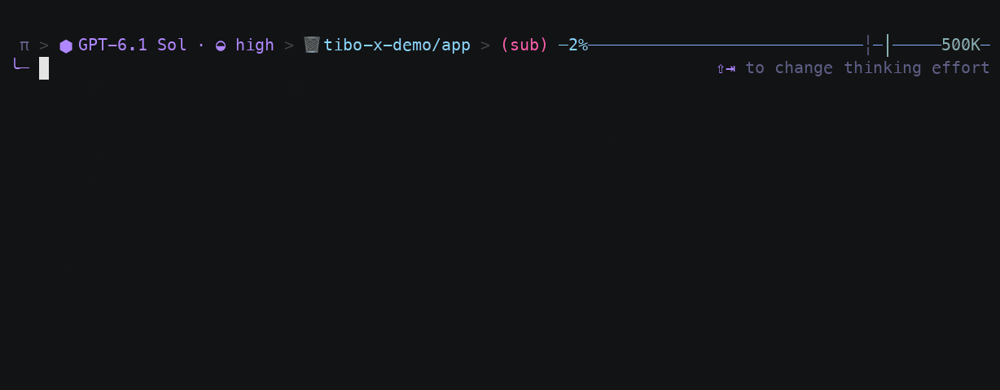
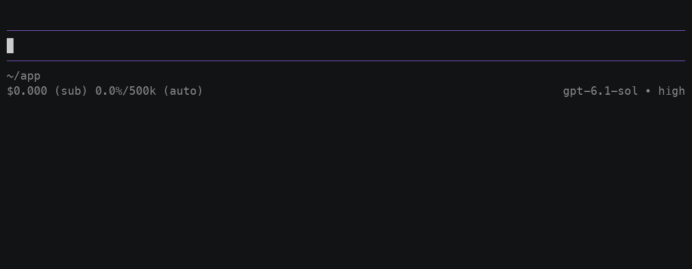

<p align="center">
  
</p>

<h1 align="center">Tibo Rush</h1>

<p align="center">English | <a href="README.zh-CN.md">中文</a></p>

**One-switch subscription quota sprint modes for Oh My Pi and Pi.**

Codex subscription quota resets on a schedule, and whatever you don't use doesn't carry over. With one command, Tibo Rush flips every connected session into a sprint mode that spends quota faster. When you're done, `off` returns each session to the setup it had before, instead of resetting everything to a single default.

Choose `regular`, `fast`, `extreme`, `off`, or `status` from the host's argument list instead of memorizing the command arguments. Tibo Rush is an OMP/Pi extension, not a standalone terminal command.

```text
/tibo-rush regular
/tibo-rush fast
/tibo-rush extreme
/tibo-rush off
/tibo-rush status
```

**Oh My Pi**



*Oh My Pi 18.12.6 in an isolated project: open the five-option list, filter with `f`, accept and run `fast`, then run `off`. The host changes from Sol (high) to Astra (medium) and restores Sol. Synthetic credentials; no model requests.*

[Download MP4](https://github.com/happyfeetw/tibo-rush/releases/download/v0.3.0/tibo-rush-omp-picker.mp4)

**Pi**



*Pi 1.4.0 follows the same selection, application and restoration flow. An offline test provider supplies the model catalog and synthetic credentials; the recording demonstrates host settings, not provider authentication or server-side priority.*

[Download MP4](https://github.com/happyfeetw/tibo-rush/releases/download/v0.3.0/tibo-rush-pi-picker.mp4)

> **Community project.** Not affiliated with OpenAI, Tibo, Oh My Pi or Pi.
> It runs inside the host process and is **not a sandbox**. Read the source before you install it.
> It doesn't read your quota or predict when it resets, so you decide when to sprint. It doesn't guarantee faster responses, quota gains, or model availability.

## Contents

- [Installation](#installation)
- [Using it](#using-it)
- [Configuration](#configuration)
- [How state and recovery work](#how-state-and-recovery-work)
- [Uninstalling](#uninstalling)
- [Development](#development)

## Installation

Currently adapted to the Oh My Pi 18.12.5 / 18.12.6 and Pi 1.4.0 host APIs. Host acceptance has only been run on macOS, so Windows and Linux host behavior is not verified. Development tools need Bun 1.3 or newer. Pi 1.4.0 needs Node 22.19 or newer.

The argument picker is included in 0.3.0. Install or update the extension before reloading the host.

### Oh My Pi

Inside an OMP session:

```text
/marketplace add happyfeetw/tibo-rush
/marketplace install tibo-rush-omp@tibo-rush
/restart
```

Or from a terminal:

```sh
omp plugin marketplace add happyfeetw/tibo-rush
omp plugin install tibo-rush-omp@tibo-rush
```

Update or reinstall the extension before running `/restart` in each open OMP session to load new code. Once loaded, switching modes does not require another restart.

### Pi

Install from git. This uses the main repository's Pi manifest and loads only the Pi adapter, not OMP:

```sh
pi install git:github.com/happyfeetw/tibo-rush@v0.3.0
```

After updating the installed source, run `/reload` in each open Pi session, or quit and resume it. The commands are the same as in OMP.

If you prefer a host-specific package, download `tibo-rush-pi-0.3.0.tgz` or `tibo-rush-omp-0.3.0.tgz` from the [Releases page](https://github.com/happyfeetw/tibo-rush/releases), unpack it into a fixed directory, and install from there:

```sh
pi install /absolute/path/to/package
omp plugin link /absolute/path/to/package
```

Each package only contains its own adapter and the shared core. **Pick one install method per host.** Installing the same host twice loads the extension twice.

The Pi gallery finds packages through npm, so a git install or a GitHub release does not by itself list Tibo Rush there.

## Using it

The same commands work in both hosts:

```text
/tibo-rush regular
/tibo-rush fast
/tibo-rush extreme
/tibo-rush off
/tibo-rush status
```

Use `/tibo-rush` inside OMP or Pi:

1. Type `/tibo-rush ` to request argument suggestions. If the list stays closed, start typing a prefix such as `f`.
2. Use the arrow keys to choose an item. With the argument list open, Enter inserts it; press Enter again to run it.
3. Check that the notification says `applied`. Choose `off` to restore the session's pre-mode settings; `status` reports the current state.

Submitting `/tibo-rush` with genuinely empty handler arguments still reports status. A trailing space does not open the list on every host entry path.

<details>
<summary>Keyboard behavior by host</summary>

- **Oh My Pi 18.12.6:** typing through `/tibo-rush ` while the command-name list is already open updates it to the five tokens, in catalog order. Tab-accepting a unique command-name prefix (`/tibo-rus` then Tab) also opens that argument list immediately. With the argument list open, Enter inserts the highlighted token (`regular` if you have not moved the highlight) and does not submit; a second Enter runs that token. If the token is already fully typed, one Enter submits. `/tibo-rush` with no trailing space, or Esc then Enter after dismissing the list, still submits empty args as status. Prefix text such as `f` or `ex` filters the list. Paste and history restore are not claimed.
- **Pi 1.4.0:** typing through `/tibo-rush ` while the command-name list is already open updates it to the argument list. Tab-accepting the command name leaves `/tibo-rush ` without opening the argument list until you type another character. With the argument list open, the first Enter inserts the highlighted token (`regular` if you have not moved the highlight) and does not submit; a second Enter runs that token. `/tibo-rush` with no trailing space, or Esc then Enter after dismissing the list, still submits empty args as status. Tab after the command may complete files. Paste and history restore are not claimed.
- Loaded extensions keep the previous code until the host reloads: `/restart` on Oh My Pi, `/reload` or a new session on Pi.

</details>

`regular` is an everyday setup. `fast` and `extreme` are the sprint modes: `fast` moves the main model to the preset's sprint setup, and `extreme` adds the priority (Fast) service tier on top. How priority requests count against your quota is up to the provider.

The example preset (`presets/tibo-rush.json`) defines these modes:

| Mode | Main model | OMP everyday coding | Request service tier |
| --- | --- | --- | --- |
| `regular` | Sol, high thinking | Sol, high | Standard |
| `fast` | Astra, medium thinking | Sol, high | Standard |
| `extreme` | Astra, medium thinking | Sol, high | Priority / Fast |
| `off` | Restores each session's original state | Restores its original routing | Restores its original tier |

The preset also routes review to Astra high, hard problems to Astra xhigh, frontend work to Gemini, and light tasks to Luna. These are the author's model IDs. **They are not available on every account.** Check the IDs against your own account's model list and edit the preset before using it. Tibo Rush does not install agent definitions, create subscriptions, read another host's login files, or redeem account benefits.

### What each host actually changes

The commands are the same, but the hosts expose different controls, and Tibo Rush does not pretend otherwise.

- **OMP** applies the main model, thinking level and service tier. It also sets OMP's own role and sub-agent routing.
- **Pi** applies the main model and thinking. For the native ChatGPT Codex endpoint, it also sets `service_tier` through `before_provider_request`, and leaves other APIs' requests alone. Pi has no equivalent of OMP's role routing, so Tibo Rush does not claim to set coding, review or frontend sub-agent models on Pi. The status output records the host and its capabilities. We checked the hook on a real Pi install using a synthetic provider payload. We have not tested server acceptance or actual speed against OpenAI.
- `priority` availability and billing are decided by the provider. Policy validation rejects `ultrafast`. A sub-agent can only use `priority` if its model is explicitly an OpenAI or Codex model.
- Tibo Rush does not rewrite your host's existing fallback chains, review gates, search provider order, or third-party sub-agent extensions. If a host falls back to another provider, the host decides the actual routing and speed. Review your fallback config yourself.

## Configuration

The default shared state directory is **`~/.tibo-rush`**. Override it with `TIBO_RUSH_HOME`. OMP and Pi sessions that share a directory receive the same requests. Use a separate directory for each group that should be isolated. This does not sync across machines.

To customize the policy:

```sh
mkdir -p ~/.tibo-rush
cp presets/tibo-rush.json ~/.tibo-rush/policies.json
```

Edit the full JSON, mainly `modes.regular`, `modes.fast` and `modes.extreme`:

- `main`: `provider`, `id`, `thinking`. Only `openai-codex` is supported as the main provider. Tibo Rush does not imply equivalent speed controls for other providers.
- `roles`: OMP model role mapping.
- `agentModels`: maps an OMP agent name to a model or an `@role`. Any role you reference must be declared in the policy. The agent definition itself must already exist.
- `tier`: `default` or `priority`.
- `agentTiers`: per-agent service tier for OMP. `priority` needs an explicit OpenAI/Codex target, either directly or through its role. `ultrafast` is not allowed.
- `instruction`: a human-readable note. It has to match what the mode really does. On Pi it is not used to claim that OMP routing took effect.

After editing, run the mode command again so each session picks up the new revision. An invalid policy is never written as the new active request. **Even a corrupted policy file does not stop `off` from working.** If a model or its auth is unavailable, you get an error. Tibo Rush does not quietly switch to another channel.

## How state and recovery work

Tibo Rush is built around one rule: a mode is only reported as applied after the original state has been saved and the change has taken effect.

- Changing mode never interrupts a running model call. A busy main session shows `pending` and switches once it is idle. In OMP, sub-agent routing can be updated first, but sub-agents that are already running are not restarted.
- `status` only counts sessions with a live heartbeat. Zero clients does not mean everything is applied. `pending` is not `applied`. A failure is never reported as `applied`.
- Changes are session-level overrides. Your persistent role configuration is not rewritten. `off` restores each session to its state from before the mode was applied. It does not reset every session to Sol.
- If a session is closed while a mode is active, its restore baseline is kept. If you run `off` while it is offline, resuming the session still attempts the restore.
- **OMP:** the current session is found through the public SDK registry. Tibo Rush checks the session ID and manager identity before changing thinking settings, and it confirms the restore record is written to disk. If the identity does not match or an SDK capability is missing, it refuses to change anything. If the disk write fails, the baseline stays in place and the error is reported. An in-memory restore is never presented as persisted.
- **OMP forks and branches:** a branched or forked session inherits the original baseline through a hidden, self-contained handoff record in the host log, and that record is then written to the shared state directory. It does not treat an already-switched model as the original. Ambiguous paths are protected with temporary tokens under `handoffs/`. If both handoff stores fail, Tibo Rush reports that recovery is blocked and does not guess the parent's baseline. Log records are metadata and are not sent to the model, but they contain restore configuration, so keep them private.
- **OMP new sessions:** if a new session with no parent is created during an active mode, Tibo Rush restores the original state at an idle boundary first. That stops the new session from inheriting an active model that has no restore data. If the session is busy, creation is cancelled and you are asked to try again. If another extension vetoes the creation, the original session stays connected and the requested mode is applied again.
- **OMP timeouts:** if an async switch takes longer than the host timeout, a synchronous gate cancels the commit. If a native model setter is still running, later switches and mode changes wait. `off` stays `pending` until that operation finishes safely. Tibo Rush does not start another change to race it.
- **Verified scope:** local file sessions in the standard OMP CLI, and `--no-session`. Remote session storage injected through the SDK is not verified. A persistent session may create its log file early because of restore confirmation. `--no-session` only restores in memory.
- **Durability:** persistence relies on the host's flush semantics. That covers the software crashes that were tested. It is not a power-loss fsync guarantee. Automatic recovery is not guaranteed if someone deletes the restore metadata by hand.
- **Manual changes:** if you change the model, thinking or tier with a host command while a mode is active, Tibo Rush reports drift and does not override your new choice. Run the mode command again to re-apply it. `off` still restores the original baseline.
- **Limits:** do not open the same host session ID in more than one process. While a mode is active, avoid changing the same settings from another extension. Existing runtime mappings are restored from the snapshot taken on entry.
- **Privacy:** `state.json`, `clients/`, `baselines/` and `handoffs/` contain session IDs, working directories and restore configuration. **Do not upload them publicly.** Tibo Rush does no telemetry and makes no model requests itself.
- Host load options such as named profiles or `--no-extensions` can stop the adapter from loading. Tibo Rush can only control sessions where the adapter is actually loaded.

## Uninstalling

**Run `off` first, confirm the sessions have restored, then uninstall.** Offline sessions need to be resumed so they can restore. Do not delete restore data early.

Oh My Pi:

```text
/tibo-rush off
/marketplace uninstall tibo-rush-omp@tibo-rush
/restart
```

Pi: run `pi remove <the source you installed from>`, then `/reload`.

## Development

```text
tibo-rush/
├── src/
│   ├── core/
│   ├── cli/
│   └── hosts/
│       ├── tibo-rush-omp/
│       └── tibo-rush-pi/
├── presets/
├── tests/
├── scripts/
└── package.json
```

The shared core does not import any host API. The two adapters do not import each other, so host-specific differences stay in their own directories. The root manifest makes git installs easy, and the release build generates a separately named package for each host.

The commands below run from a git checkout. Host-specific packages do not include tests or build scripts.

`src/cli/controller.mjs` is an internal test/development controller. It has no installed command and is excluded from the root package and both host distributions.

```sh
bun test
OMP_BIN=/absolute/path/to/omp bun run smoke
PI_CLI_JS=/absolute/path/to/pi-cli.js bun run smoke:pi
bun run pack:hosts
```

Tests use an isolated state directory. The real-host smoke tests use temporary config and sessions, and they make no network model calls. The Pi lifecycle can be tested with local synthetic responses, but that says nothing about actual provider speed. A missing host or model capability does not count as a pass. The offline checks in GitHub CI do not replace real host acceptance.

Synthetic test credentials live in `tests/fixtures/offline-provider.mjs`. See [SECURITY.md](SECURITY.md) for how to report a vulnerability.

`pack:hosts` writes `dist/tibo-rush-omp-<version>.tgz` and `dist/tibo-rush-pi-<version>.tgz`. These only contain whitelisted source and no runtime state. Before a release, you also need to verify marketplace and package installs, and check that new sessions load the extension.

## License and references

[MIT](LICENSE). The source was extracted from the author's local extensions. It does not include any host's source code or personal session records.

- [Oh My Pi](https://github.com/can1357/oh-my-pi)
- [OMP marketplace docs](https://github.com/can1357/oh-my-pi/blob/main/docs/marketplace.md)
- [Pi package spec](https://github.com/badlogic/pi-mono/blob/main/packages/coding-agent/docs/packages.md)
- [Pi extension spec](https://github.com/earendil-works/pi/blob/main/packages/coding-agent/docs/extensions.md)
