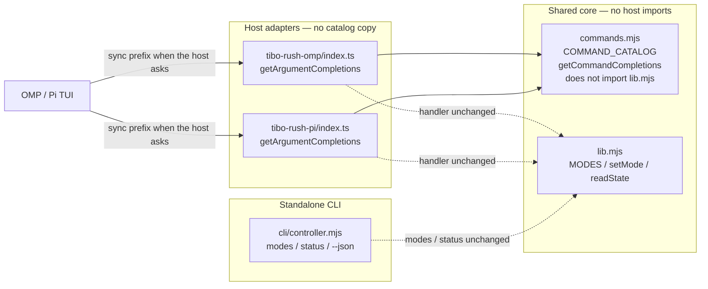

# Tibo Rush slash-command option picker and argument autocomplete

| Field | Value |
| --- | --- |
| **Date** | 2026-10-26 |
| **Status** | Implemented (option A, host TUI picker). CLI `--complete` and README shell snippets withdrawn 2026-10-26. |
| **Repo** | https://github.com/happyfeetw/tibo-rush |
| **Tracking issue** | https://github.com/happyfeetw/tibo-rush/issues/12 |
| **Current product version** | 0.2.1 |
| **Target hosts** | Oh My Pi 18.12.6 (gate), 18.12.5 if a checklist row exists; Pi 1.4.0 |
| **Implementation branch** | `feat/command-completions` from `main` |

This document is the implementation spec for [#12](https://github.com/happyfeetw/tibo-rush/issues/12). Sections **Contracts**, **Host-controlled TUI**, and **Q1 (closed: option A)** are the source of truth. **Verification** is the plan that was executed; **[Implementation acceptance](#implementation-acceptance-2026-10-26)** is the recorded result. Other sections point at them instead of restating conflicting rules.

**Scope correction (2026-10-26):** #12’s command-line autocomplete is the Oh My Pi / Pi **input-box** argument list (`getArgumentCompletions`). Standalone CLI `--complete` and bash/zsh/fish README snippets shipped in PR #13 and were withdrawn. They are not product surface. Historical rows in [Implementation acceptance](#implementation-acceptance-2026-10-26) record what PR #13 contained.

---

## Overview

`/tibo-rush` currently registers a free-text argument on Oh My Pi and Pi. Users must type a full token (`regular`, `fast`, `extreme`, `off`, or `status`). There is no argument list.

This design adds a **host-agnostic command catalog and synchronous completer** in `src/core/commands.mjs` and wires it into both adapters as `getArgumentCompletions`.

The hook can only return candidates. **When the list opens, whether Enter submits or accepts a row, and whether a trailing space is enough to show five tokens, are host TUI behavior.** They are recorded per host. They are not inferred from the other host, and they are not the same as “the slash handler still treats empty args as status.”

Mode semantics, restore/`off`, policies, `state.json`, baselines, and model traffic stay unchanged. Completions are hints; unknown tokens still error.

---

## Background & Motivation

### Current command surface

The same five tokens work on OMP, Pi, and the standalone CLI:

```text
/tibo-rush regular
/tibo-rush fast
/tibo-rush extreme
/tibo-rush off
/tibo-rush status
```

CLI: `tibo-rush <mode>`, `tibo-rush status`, `tibo-rush status --json`. `--json` may appear anywhere; `run()` strips every `--json` then parses the remaining argv.

Modes live in `src/core/lib.mjs`:

```js
export const MODES = ["off", "regular", "fast", "extreme"];
```

`status` is a read-only command, not a mode. Empty **slash-command** args currently default to `status` in both adapters (`const mode = args.trim() || 'status'`). Empty **CLI** argv prints USAGE and `process.exit(1)`.

OMP registration (`src/hosts/tibo-rush-omp/index.ts`, `pi.registerCommand` around line 827) is description + handler only. Pi (`src/hosts/tibo-rush-pi/index.ts`, around line 331) is the same shape. Neither adapter passes `getArgumentCompletions`. The standalone CLI has USAGE text but no completion hook.

### Pain

- Users must recall the exact lowercase token. A typo (`warp`, `Off`, `fastt`) is rejected after submit, not while typing.
- Issue #12 asks for a selectable argument list after `/tibo-rush `, plus CLI tab completion of the same tokens.
- Token names and one-line descriptions are already duplicated across adapters, CLI USAGE, and both READMEs.

### Host APIs (do not invent others)

**Oh My Pi 18.12.x** (`@oh-my-pi/pi-coding-agent`):

```ts
pi.registerCommand(name: string, options: {
  description?: string;
  getArgumentCompletions?: (argumentPrefix: string) => AutocompleteItem[] | null; // SYNCHRONOUS
  handler: (args: string, ctx: ExtensionCommandContext) => Promise<void>;
}): void;
```

The 18.12.6 binary contains `getArgumentCompletions` call sites. **Do not add an npm dependency on `@oh-my-pi/pi-tui`.** Return `{ value, label, description }`. The OMP adapter type-imports only from `@oh-my-pi/pi-coding-agent`.

OMP built-in subcommand completers fold case and often append a trailing space on `value` because they expect a second argument. Tibo Rush does **not** fold case (`MODES.includes` is case-sensitive) and does **not** append a trailing space (`/tibo-rush` takes one token).

OMP 18.12.6 **TUI** keystroke behavior (Enter with an open argument list, whether space opens the list when it was closed) is **not** copied from Pi. Record it on the OMP checklist. Component-level inspection of the OMP binary is not a TUI pass.

**Pi 1.4.0** (`@earendil-works/pi-coding-agent`, `@earendil-works/pi-tui` 1.4.0):

```ts
getArgumentCompletions?: (argumentPrefix: string) =>
  AutocompleteItem[] | null | Promise<AutocompleteItem[] | null>;
```

Keep the function **synchronous** on Pi as well. `applyCompletion` inserts `item.value` as-is.

Pi 1.4.0 `CombinedAutocompleteProvider.getSuggestions` (`pi-tui` `autocomplete.js`) calls `getArgumentCompletions(argumentText)` only when `!options.force` and the buffer has a leading `/` plus a space. Explicit Tab (`force`) falls through to path completion.

Pi 1.4.0 editor (`pi-tui` `editor.js`):

- `tui.select.confirm` (Enter) with an open list whose prefix does **not** start with `/` applies the highlighted item and **does not submit**. Argument-list prefix is the argument remainder, so it does not start with `/`.
- `insertCharacter` retriggers slash completions for `/`, `@`/`#`, or `[a-zA-Z0-9.\-_]`. **Space is not a trigger** when the list is closed. Space **updates** an already-open list.
- Tab-accept of a unique command name applies `/name ` and returns without chaining argument completions.
- `handlePaste` / `setText` / history navigation cancel autocomplete and do not retrigger it.

There is no RPC for “what would the dropdown show.” Smoke can assert registration and invoke `/tibo-rush <token>` as a local command; it cannot drive the interactive picker.

---

## Goals & Non-Goals

### Goals

1. **Wire a shared argument completer** so that whenever a host asks for `/tibo-rush` argument completions, it receives `regular | fast | extreme | off | status` with short bilingual descriptions, prefix-filtered, `value` without a trailing space. OMP 18.12.6 is the primary TUI surface for #12.
2. **Same completer on Pi 1.4.0**, so the two hosts keep one command surface. A recorded Pi 1.4.0 picker is a merge gate for any README sentence that names Pi’s picker.
3. **Single source of truth** for token names and picker descriptions in `src/core/commands.mjs`. That file must not import `lib.mjs` or any host API. Completer unit-tested with `bun test`.
4. **Handler and restore contracts unchanged:** slash handler empty args → `status`; CLI with no args stays USAGE / exit 1; unknown token → error; `setMode` / reconcile / `off` untouched. This is **not** a claim that every TUI keystroke still means what it meant in 0.2.1 once a list is on screen.
5. **Docs** that match the hook **and** the recorded host limits (see [Host-controlled TUI](#host-controlled-tui)).
6. **Tracking:** issue #12; one implementation PR (`Closes #12`); later release PR for marketplace version.

Issue #12’s user-facing sentence — “after `/tibo-rush ` a selectable list appears” — is the intended UX. **Q1 is closed as option A:** ship the native `getArgumentCompletions` hook, document each host’s trigger limits, and do not add a custom autocomplete provider, editor, or post-submit picker. A trailing space after `/tibo-rush` does **not** always open the five-row list. The host decides when to call the hook.

### Non-Goals

- Changing mode semantics, policy schema, `state.json`, baselines, handoffs, or persistent role config.
- Inventing an `omp` native subcommand, a new slash command name, or aliases.
- Fuzzy / case-insensitive matching, multi-argument completion, or completing `--json` / `--help` as options.
- Adding `@oh-my-pi/pi-tui` or `@earendil-works/pi-tui` as a dependency.
- Automating the TUI dropdown in smoke tests, or claiming Windows/Linux TUI verification.
- Bumping marketplace / package version in the implementation PR.
- Shipping a completion framework, `contrib/` scripts, `--completion-script`, CLI `--complete`, or bash/zsh/fish README snippets. #12 is the host input-box picker.
- Post-submit `ctx.ui.select()` / `ctx.ui.custom()`.
- Custom editor or `autocomplete` provider wrapping the host TUI.
- Network, model, or quota calls from the completer, including reading `policies.json` / `state.json` on each keystroke.
- Reordering catalog rows, wrapping the handler, or adding extra UI so that Enter-on-open-list looks like empty-arg status.

---

## Contracts

These rules are normative. Later examples must not contradict them.

### C1. Completer (extension-owned)

`getCommandCompletions(argumentPrefix)` is synchronous, pure, and never throws.

| Input | Output |
| --- | --- |
| `""` | all five items, catalog order |
| prefix without whitespace that `startsWith`-matches one or more `value`s | those items |
| no match, non-string, or any whitespace in the prefix | `null` |

`value` is exactly `regular` / `fast` / `extreme` / `off` / `status` — never `` `${name} ` ``. Matching is case-sensitive. Empty prefix **showing** `status` is not the same event as the handler **running** status.

The completer does not read policies, state, env, or the filesystem. It must not import `lib.mjs`.

### C2. Slash handler (extension-owned, unchanged)

When the host **invokes** the command with `args.trim() === ""`, the handler still runs read-only **status**. When it invokes with a mode token, it still `setMode`. When it invokes with an unknown token, it still errors and does not write `state.json`.

### C3. CLI (extension-owned, unchanged)

No args → USAGE, exit 1. There is no `--complete` flag. `--complete` is an unknown command.

### C4. Host TUI (host-owned)

The extension does not control:

- whether the host calls `getArgumentCompletions` after a space, Tab, paste, or history restore;
- whether Enter with an open list submits, or applies the highlighted row;
- Tab vs list.

**Empty completion prefix**, **empty handler args**, and **Enter consumed by the list** are three different events. Do not describe them as one “empty input” behavior.

### C5. Shell snippets

Withdrawn. README does not ship bash/zsh/fish completion snippets.

---

## Key Decisions

| Decision | Choice | Rationale |
| --- | --- | --- |
| Catalog location | `src/core/commands.mjs`, **no** `lib.mjs` import | `lib.mjs` owns state/policy and pulls `fs`. Catalog is UX. Tests import both modules to assert `MODES ⊂ catalog`. |
| Host coverage | OMP **and** Pi in the same change | One command surface. Pi TUI recording is a merge gate for *naming* Pi, not a reason to omit the hook. |
| Completer shape | Sync `{ value, label, description }`; `null` when hidden | Matches OMP’s sync-only hook and Pi 1.4.0 items. No `pi-tui` dependency. |
| Completion `value` | Token **without** a trailing space | One-argument command. Hosts insert `item.value` as-is. |
| Empty prefix | Return all five tokens, including `status` | That is what the hook should return when asked. It does not mean Enter submits status. |
| Prefix match | Case-sensitive `startsWith` | Handler is case-sensitive. OMP builtins fold case; Tibo Rush does not. |
| Picker copy | Policy-neutral bilingual one-liners; **no** model IDs and **no** implied `priority` | Completer cannot read `policies.json`. `policyFor()` accepts `extreme.tier = "default"` and non-priority `agentTiers`. |
| Item order | `regular`, `fast`, `extreme`, `off`, `status` | README command block. Independent of `MODES` (`off` first). |
| Enter / space / Tab | Document per host; do not change handler or catalog order | Covering Pi’s first-item Enter by putting `status` first, or adding a post-submit picker, would hide the host behavior. |
| CLI `--complete` | **Withdrawn.** Unknown command; not listed in USAGE | #12 is the host input-box picker. PR #13 shipped `--complete` and it was removed. |
| Shell snippets | **Withdrawn.** No README snippets | Same. |
| Versioning | Minor **0.3.0** in a follow-up release PR | New user-visible capability. Feat PR does not bump. |
| Feature flag | None | Completer cannot affect restore/`off`. Missing list = type tokens as today. |
| TUI architecture | Stay on `getArgumentCompletions` (Q1 = A) | Custom editor / provider is out of scope. Host trigger gaps are documented, not closed by new TUI architecture. |

---

## Proposed Design

### Architecture



`commands.mjs` does **not** import `lib.mjs`. Core still does not import `@oh-my-pi/*` or `@earendil-works/*`. Adapters still do not import each other. `MODES` remains the validation set for `setMode` / `policyFor` / `state.json`. The catalog is the UX list (`MODES` + `status`) and must not invent a sixth mode. `MODES ⊂ catalog` is enforced in `tests/commands.test.mjs` by importing both modules.

### Command catalog

New file: `src/core/commands.mjs`. Hard-code the five rows.

Picker `description` strings (source of truth for the catalog; tests check behavior and policy-neutral copy, not these exact bilingual literals):

| `value` (= `label`) | `description` |
| --- | --- |
| `regular` | `日常档 / Everyday preset` |
| `fast` | `冲刺档 / Sprint preset` |
| `extreme` | `极限档 / Extreme preset` |
| `off` | `恢复入档前状态 / Restore pre-mode setup` |
| `status` | `只读状态 / Read-only status` |

Why this copy:

- Bilingual, short enough for a TUI row.
- No Sol / Astra / GPT-6. Those live in `presets/tibo-rush.json` and can be overridden.
- No “priority” / “Fast” on `extreme`. Bundled `presets/tibo-rush.json` uses `extreme.tier = "priority"` and several `agentTiers: "priority"`, but `parsePolicy` in `src/core/lib.mjs` accepts `tier` of `"default"` **or** `"priority"`, and `agentTiers` may omit `priority`. A keystroke completer that cannot read policy must not claim the live configuration.
- `off` is “pre-mode setup,” the real restore contract.
- `status` is labeled read-only so it is not mistaken for a mode.

Slash-command **registration** descriptions stay host-specific and English (capability limits, not token meaning):

- OMP: `Global Tibo Rush configurable presets: regular | fast | extreme | off | status`
- Pi: `Global Tibo Rush: regular | fast | extreme | off | status (Pi has no OMP role routing)`

Do not move those strings into the catalog. CLI USAGE may keep its longer bundled-default lines (including the existing `extreme` help sentence). USAGE is not the picker; do not copy USAGE into `description`.

Illustrative module (shape, not a paste mandate):

```js
/** @typedef {{ value: string, label: string, description: string }} CommandCompletion */

/** @type {CommandCompletion[]} */
export const COMMAND_CATALOG = [
  { value: "regular", label: "regular", description: "日常档 / Everyday preset" },
  { value: "fast",     label: "fast",     description: "冲刺档 / Sprint preset" },
  { value: "extreme",  label: "extreme",  description: "极限档 / Extreme preset" },
  { value: "off",      label: "off",      description: "恢复入档前状态 / Restore pre-mode setup" },
  { value: "status",   label: "status",   description: "只读状态 / Read-only status" },
];

/**
 * Synchronous argument completer for `/tibo-rush`.
 * Never throws. Returns null when the host should hide the list.
 *
 * @param {unknown} argumentPrefix
 * @returns {CommandCompletion[] | null}
 */
export function getCommandCompletions(argumentPrefix) {
  try {
    if (typeof argumentPrefix !== "string") return null;
    if (/\s/.test(argumentPrefix)) return null;
    const items = COMMAND_CATALOG
      .filter((item) => item.value.startsWith(argumentPrefix))
      .map((item) => ({ value: item.value, label: item.label, description: item.description }));
    return items.length > 0 ? items : null;
  } catch {
    return null;
  }
}
```

Invariant tests in `tests/commands.test.mjs` (import catalog from `commands.mjs` **and** `MODES` from `lib.mjs`). Derive token lists from `COMMAND_CATALOG`; do not export an unused `COMMAND_VALUES` helper.

- Catalog values in order are `["regular", "fast", "extreme", "off", "status"]`.
- `MODES.every((m) => catalogValues.includes(m))`.
- `status` is in the catalog and `'status' ∉ MODES`.
- Every `value === label`, no trailing whitespace on `value` or `label`.
- Each `description` is a non-empty string. Do not lock the exact bilingual sentence in tests. Human-review the catalog table, including that `extreme` stays policy-neutral.

Do **not** change `MODES` order in `lib.mjs`.

### Completer contract

See [C1](#c1-completer-extension-owned). Additional cases:

| Input `argumentPrefix` | Output |
| --- | --- |
| `"f"` / `"fast"` | `fast` only |
| `"ex"` | `extreme` only |
| `"z"` / `"Off"` / `"FAST"` | `null` |
| `"fast "` / `"fast extra"` / `"fast\t"` | `null` |
| `null` / `undefined` / `1` | `null` (no throw) |
| `"a".repeat(1e6)` | `null` (no throw; unit test only) |

Call frequency: once per host request (often once per keystroke). Target: well under 1 ms on normal prefixes. Zero I/O.

### Adapter wiring

```ts
import { getCommandCompletions } from '../../core/commands.mjs';

pi.registerCommand('tibo-rush', {
  description: /* existing host-specific string, unchanged */,
  getArgumentCompletions: getCommandCompletions,
  handler: async (args, ctx) => { /* existing body, unchanged */ },
});
```

Handler body stays as-is (`args.trim() || 'status'`, then `MODES` / `setMode`). Do not wrap the completer in `async`.

Pi still does not apply OMP role routing. Completions do not claim otherwise. README may name Pi’s picker only after the Pi 1.4.0 checklist is recorded.

### Host-controlled TUI

#### Three events

| Event | Who | What it is | What it is not |
| --- | --- | --- | --- |
| Empty **completion prefix** | Completer, when the host calls it with `""` | Return five rows, including `status` | Not a submit |
| Empty **handler args** | Slash handler, when the host actually runs the command with blank args | Read-only `status` | Not “Enter while the list is open” |
| **Enter consumed by the list** | Host TUI | Host-defined (Pi 1.4.0 and OMP 18.12.6 both insert the highlight; they are recorded separately) | Not handler empty-args |

0.2.1 had no argument list, so Enter after `/tibo-rush ` submitted empty args. Shipping `getArgumentCompletions` changes keystroke meaning **if the host shows a list**. The handler is unchanged; the interaction is not.

Do not mitigate this by putting `status` first, wrapping the handler, or adding a second UI.

#### Pi 1.4.0 (component + prior TUI reproduction)

Evidence: reviewer TUI reproduction, plus `@earendil-works/pi-tui` 1.4.0 `editor.js` / `autocomplete.js` (not a substitute for the feat-PR TUI checklist).

| Path | List | Enter / result |
| --- | --- | --- |
| Continuously type `/tibo-rush ` (command-name list already open) | Space **updates** the open list; empty prefix → five tokens | First Enter applies highlighted row (`regular` if untouched). Buffer becomes `/tibo-rush regular`. **Not submitted.** Second Enter runs `setMode("regular")`. |
| `/tibo-rush` with **no** trailing space, Enter | No argument list | Handler args empty → **status** |
| Argument list open, Esc, then Enter | List cancelled | Handler args empty → **status** |
| Type `/tibo-rus`, Tab-accept unique command name | Completes to `/tibo-rush ` and **closes** the list. Space is not a closed-list trigger. | Argument list stays closed until a later trigger character (e.g. `f` → `fast`) |
| Paste `/tibo-rush ` or restore it from history | `handlePaste` / history **cancel** autocomplete and do not retrigger | **Not TUI-verified.** Component code says the list does not open. Feat-PR checklist must not claim paste/history unless separately recorded. |
| Tab after `/tibo-rush ` (`force`) | Argument completer is skipped | Files / path completion possible. Do not promise Tab equals the picker. |

```mermaid
sequenceDiagram
  participant U as User
  participant T as Pi 1.4.0 TUI
  participant C as getCommandCompletions
  participant H as slash handler

  rect rgb(245,245,245)
    Note over U,H: Continuous typing — list already open
    U->>T: type "/tibo-rush "
    T->>C: argumentPrefix ""
    C-->>T: five items including status
    Note over T: list visible; nothing submitted
    U->>T: Enter (list still open)
    Note over T: applies highlighted value (regular if untouched)
    T-->>U: buffer "/tibo-rush regular"
    U->>T: Enter
    T->>H: args "regular"
    H-->>U: setMode("regular")
  end

  rect rgb(245,245,245)
    Note over U,H: No trailing space
    U->>T: "/tibo-rush" then Enter
    T->>H: args ""
    H-->>U: status
  end

  rect rgb(245,245,245)
    Note over U,H: Dismiss the list
    U->>T: list open, Esc, Enter
    T->>H: args ""
    H-->>U: status
  end

  rect rgb(245,245,245)
    Note over U,H: Tab-accept command name
    U->>T: "/tibo-rus" then Tab
    T-->>U: buffer "/tibo-rush " list closed
    Note over T: getArgumentCompletions not called
    U->>T: type "f"
    T->>C: argumentPrefix "f"
    C-->>T: fast only
  end
```

#### OMP 18.12.6 / 18.12.5

The hook is the same. **Do not copy the Pi table onto OMP.**

Recorded on OMP **18.12.6** isolated TUI (feat implementation pass; not copied from Pi):

| Path | List | Enter / result |
| --- | --- | --- |
| Continuously type `/tibo-rush ` (command-name list already open) | Space updates the open list; empty prefix → five tokens in catalog order | First Enter inserts highlighted row (`regular` if untouched). Buffer becomes `/tibo-rush regular`. **Not submitted.** Second Enter runs that token. |
| Tab-accept unique command-name prefix (`/tibo-rus` then Tab) | Completes to `/tibo-rush` **and opens the argument list immediately** | Unlike Pi 1.4.0, no extra trigger character is required |
| `/tibo-rush` with **no** trailing space, Enter (command list showing `tibo-rush`) | Command-name list, not the argument list | Handler args empty → **status** |
| Argument list open, Esc, then Enter | List cancelled; buffer still `/tibo-rush` | Handler args empty → **status** |
| Token already fully typed (`/tibo-rush status`, `/tibo-rush off`) | Unique row | One Enter submits |
| Paste `/tibo-rush ` or history restore | **Not TUI-recorded** | Do not claim |

OMP 18.12.5 was not launched in this pass. Do not claim 18.12.5 TUI from the 18.12.6 row.

### Empty-args vs empty-prefix vs consumed Enter

| Surface | Input | Result |
| --- | --- | --- |
| Slash handler invoked with blank args | `args.trim() === ""` | **status** (unchanged) |
| Completer asked with `""` | host called the hook | five tokens, including `status` |
| Pi 1.4.0: Enter while argument list is open | list consumes Enter | highlighted token inserted; **not** status |
| CLI `tibo-rush` with no args | `args.length === 0` | **USAGE, exit 1** |

### Standalone CLI: --complete (withdrawn)

PR #13 added `tibo-rush --complete [prefix]` and README bash/zsh/fish snippets. Those were withdrawn: `--complete` is an unknown command, USAGE does not list it, and README has no shell snippets. The catalog remains for the host TUI hook only. CLI `controller.mjs` does not import `commands.mjs`.

### Handler remains the source of truth

Typing `/tibo-rush warp` still errors and does not write `state.json`. The completer must not hide `extreme` when policy is broken: `setMode("extreme")` already rejects a bad policy, and hiding the token would pretend the mode does not exist. The completer also must not read policy to special-case `priority`.

---

## API / Interface Changes

### Host extension API (OMP + Pi)

| Field | Before | After |
| --- | --- | --- |
| `description` | host-specific string listing tokens | **unchanged** |
| `handler` | trim → status / `MODES` / `setMode` | **unchanged** (empty **invoked** args still `status`) |
| `getArgumentCompletions` | absent | `getCommandCompletions` |

No new slash command. Existing sessions still need `/restart` (OMP) or `/reload` (Pi) to load the hook.

### CLI

| Invocation | Before 0.2.1 | After (current) |
| --- | --- | --- |
| `tibo-rush <mode>` | set requested mode | unchanged |
| `tibo-rush status` | read-only | unchanged |
| `tibo-rush` (no args) | USAGE, exit 1 | **unchanged** |
| `tibo-rush --help` | USAGE | **unchanged** (no `--complete` line) |
| `tibo-rush --complete` | unknown mode, exit 1 | **unknown mode, exit 1** (PR #13 flag withdrawn) |

### Types

No `state.json` / `RushState` / `RushClient` change. Optional JSDoc in `commands.mjs` is enough.

---

## Data Model Changes

**None.** No migration. Completions do not persist. Existing sessions keep their requested mode; they only need `/restart` or `/reload` to load new extension source.

`scripts/package.mjs` already copies `src/core`, so `commands.mjs` is included in both host tarballs. Root `package.json` `"files"` already includes `src/`. CI `npm pack --dry-run` file count increases by one; that is expected.

---

## Alternatives Considered

### 1. Post-submit `ctx.ui.select()` instead of `getArgumentCompletions`

Would change empty-args semantics (today: status) and does not match an inline list while typing. **Rejected.**

### 2. Copy token lists into each adapter + CLI

Five copies, immediate drift, adapters cannot be imported in `bun test`. **Rejected.**

### 3. Defer Pi; ship OMP-only

Forks the command surface for ten lines. **Rejected.** Recording Pi TUI is a merge gate for *naming* Pi, not for omitting the hook.

### 4. Trailing space on `value`

Builtins that append `" "` expect a second argument. `/tibo-rush` does not. **Rejected.**

### 5. `contrib/` + `--completion-script`

Packaging cost; marketplace users still lack the binary. **Deferred** past 0.3.0 unless requested.

### 6. Case-insensitive / fuzzy match

Handler stays case-sensitive. **Rejected** for v1.

### 7. Import `MODES` into `commands.mjs`

Would pull `fs` onto the completer module graph. Tests can import both modules. **Rejected.**

### 8. Custom editor / autocomplete provider so space always opens the list

Would close Pi’s Tab-accept / paste gap. **Rejected for this change: Q1 is option A.** Out of scope for #12 as specified (do not enlarge TUI architecture).

### 9. Put `status` first so Pi Enter-on-open-list runs status

Would mask host Enter semantics and surprise users who expect the first README token (`regular`). **Rejected.**

---

## Security & Privacy Considerations

| Threat | Severity | Mitigation |
| --- | --- | --- |
| Completer throws into the TUI | High | `try/catch` → `null`. Tests: non-strings, whitespace, 1 MiB prefix. |
| Completer reads or writes `state.json` / policies | High (contract) | No `lib.mjs` import. Completer has no I/O. Tests: no files under a private `TIBO_RUSH_HOME`. |
| Completer triggers model / network | High | No `fetch`, no `setModel`. Offline by construction. |
| Completer I/O on every keystroke to “fix” `extreme` copy | High (also UX) | Neutral catalog strings. Do not read policy to decorate `priority`. |
| Picker screenshot leaks a personal session | Medium | Throwaway demo, no paid model calls. |
| New file in the host process | Low | Static strings. Existing SECURITY.md applies. |

No new PII. No telemetry. Do not log keystrokes.

---

## Observability

Do not log, metric, or trace completions. No new CI workflow. Real-host smoke stays manual with `OMP_BIN` / `PI_CLI_JS`.

---

## Rollout Plan

No feature flag.

1. Design accepted (this document, including [Q1 closed as option A](#q1-issue-12-list-after-tibo-rush--vs-pi-140-triggers)).
2. Implementation PR on `feat/command-completions` from **`main`**. `Closes #12`.
3. Manual macOS TUI: OMP **18.12.6** merge gate; **18.12.5** only with its own row; Pi **1.4.0** merge gate for naming Pi. Checklist rows must include the host-specific Enter and trigger paths, not only “space shows five.”
4. Merge to `main`. Marketplace users still on 0.2.1 until a release.
5. Follow-up `release: 0.3.0`.

| Install | Load new code | State migration |
| --- | --- | --- |
| OMP marketplace / plugin | `/restart` per open session | None |
| Pi git/package | `/reload` or quit + resume | None |
| Standalone CLI | next process | none |

Rollback: revert the feat PR or reinstall 0.2.1, then `/restart` or `/reload`. Never delete `state.json` / `clients/` / `baselines/`.

Version **0.3.0** (minor): new host TUI picker capability, not a restore-contract break. Feat PR does not bump versions.

---

## Verification

This section is the **plan**. Recorded results are in [Implementation acceptance](#implementation-acceptance-2026-10-26). Do not treat `bun test` as TUI proof. Component probes are not TUI recordings.

### Unit tests (`bun test`)

`tests/commands.test.mjs`. Import catalog from `commands.mjs` and `MODES` from `lib.mjs`. Suggested cases:

1. Catalog token order `regular`, `fast`, `extreme`, `off`, `status`. Copy is human-reviewed; tests do not lock the exact bilingual `description` strings.
2. `MODES ⊂ catalog values`; `'status' ∉ MODES`.
3. `value === label`; no trailing space on `value`.
4. Empty prefix → five items.
5. `"f"` → `fast`; `"ex"` → `extreme`.
6. `"z"`, `"warp"`, `"Fast"` → `null`.
7. Whitespace → `null`.
8. Non-string → `null`, no throw.
9. 1 MiB prefix → `null`, no throw.
10. Return value is not a Promise.
11. `--complete` is an unknown command; `--help` does not list it.

Invalid-mode coverage stays in `tests/behavior.test.mjs`. Catalog `description` copy is human-reviewed; do not add a word-blacklist test.

Do **not** add tests that assert README or design-doc English/Chinese wording, exact help sentences, import statements, or adapter wiring source text.

### Real-host smoke (unchanged automation)

`OMP_BIN=… bun run smoke` and `PI_CLI_JS=… bun run smoke:pi` keep asserting registration and local `/tibo-rush <token>` with network denied. Do not add a TUI driver.

Use `OMP_BIN=/Users/wangxinduo/.local/bin/omp` (18.12.6) and

`PI_CLI_JS=/private/tmp/tibo-demo/pi-bin/node_modules/@earendil-works/pi-coding-agent/dist/bundle/cli.js` (1.4.0).

Do not use a global `pi` version as the gate.

### Manual acceptance checklist (feat PR)

Host acceptance remains **macOS only**. Throwaway project, no paid model calls, no personal session. Record pass/fail **per host**. A Pi result is not an OMP result.

**OMP 18.12.6 — merge gate** (`omp --version` → `omp/18.12.6`).

**OMP 18.12.5 — only if that binary is used for a row.** Do not claim 18.12.5 TUI from the 18.12.6 row.

1. Load the branch. `/restart`.
2. **Continuous typing:** type `/tibo-rush` then space. Record whether the five-row list appears without Tab.
3. **Tab-accept command name:** type a unique prefix of `tibo-rush`, accept with Tab (buffer should gain a trailing space). Record whether the argument list opens immediately, only after another character, or not at all.
4. **Enter with list open:** if a list is visible with empty argument prefix, press Enter once. Record buffer and whether the handler ran. If it inserted `regular` (or another highlight) without submitting, press Enter again and record `setMode`.
5. **Enter with no trailing space:** `/tibo-rush` then Enter → status notify, no mode write.
6. **Cancel then Enter:** if the host has a cancel binding (Esc or equivalent), open the list, cancel, Enter. Record whether handler args were empty (status).
7. Type `/tibo-rush f` → only `fast`. Inserted `value` has no trailing space.
8. `/tibo-rush z` / `warp` still errors; `state.json` unchanged.
9. No model request / no assistant turn.
10. `off` still restores (smoke or a quick `fast` then `off`).
11. Optional, not a gate: paste `/tibo-rush ` and history restore. Record; do not claim them without this row.
12. Optional: Tab after `/tibo-rush `. Do not fail the PR if Tab is not the picker.

**Pi 1.4.0 — merge gate for naming Pi in Using-it.** Same numbered rows after `/reload`, using `PI_CLI_JS` above. Expected from prior reproduction + 1.4.0 components (must still be **recorded** on a real TUI, not checked off from this design):

- Row 2: list opens on continuous typing.
- Row 3: Tab-accept does **not** open the argument list until a later trigger character.
- Row 4: first Enter inserts `regular` (if highlight untouched); second Enter submits `regular`.
- Row 5: no-space Enter → status.
- Row 6: Esc then Enter → status.

If the Pi checklist is skipped, README must not say Pi opens an argument picker (`Agents.md`: do not claim unverified host TUI).

**CLI:** no `--complete` flag. `tibo-rush --complete` is an unknown command. No-args still prints USAGE and exits 1.

### Packaging

- `npm pack --dry-run` includes `src/core/commands.mjs`.
- `bun run pack:hosts` both tarballs contain it.
- Host tarballs still exclude `tests/`, `scripts/`, `state.json`.

The design-only revision (before implementation) did not run those pack commands. The implementation pass did; see below.

---

## Implementation acceptance (2026-10-26)

Recorded feat-branch result. The checklist above is the plan that was executed. Pane dumps for the TUI rows live in [`docs/design/evidence/command-completions/`](evidence/command-completions/). Raw `/tmp` captures remain until the PR is opened; they are not the long-term record.

| Check | Result |
| --- | --- |
| `bun test` | Implementation pass: 36 including a description word-blacklist. Cleanup deleted that test and re-ran `tests/commands.test.mjs` (16 pass). Full suite not repeated in this cleanup. CLI `--complete` and README shell snippets were later withdrawn. |
| OMP smoke | `omp/18.12.6`, 22 checks, 0 model calls |
| Pi smoke | Pi 1.4.0, passed, network forbidden |
| `npm pack --dry-run` | 12 files including `src/core/commands.mjs` |
| `bun run pack:hosts` | both tarballs include `src/core/commands.mjs`; no tests/scripts/state |
| zsh / bash / fish Tab | Recorded for PR #13; **withdrawn** with `--complete` and README snippets |
| OMP 18.12.6 TUI | merge-gate rows recorded (see evidence) |
| Pi 1.4.0 TUI | picker rows recorded (see evidence) |
| OMP 18.12.5 TUI | not run; README does not claim 18.12.5 keys |
| Paste / history | not recorded; not claimed |
| Paid model requests | none |

TUI differences that README and this spec must keep separate:

- **OMP 18.12.6:** Tab-accept of `/tibo-rus` opens the five-row argument list immediately. Continuous typing through a trailing space also opens it. Enter on an open argument list inserts the highlight (`regular` if untouched). Fully typed token: one Enter submits. Bare `/tibo-rush` and Esc-then-Enter submit empty-arg **status**. `off` restored an applied `fast` (Astra → Sol).
- **Pi 1.4.0:** Tab-accept leaves `/tibo-rush ` without the argument list until another character (`f` → `fast`). Continuous typing through a trailing space opens the five-row list. Enter on an open list inserts the highlight. Bare command and Esc-then-Enter submit **status**. Isolated `fast` wrote the requested mode and failed to apply (no openai-codex credentials); that is **not** “applied then restored.” `off` still applied. Full apply/restore remains the smoke-pi and OMP TUI evidence.

---

## Documentation changes

Update **Using it** / **使用**. Keep host capability differences where they already live. Name a host’s picker only after that host’s checklist.

Do **not** write “type `/tibo-rush` and a space and the five candidates always appear.”

English (after the command block):

> In Oh My Pi 18.12.6, type `/tibo-rush`. When the host shows slash-command argument completions, the list is `regular`, `fast`, `extreme`, `off`, and `status`. Prefix text filters it. Arrow keys move the highlight. Continuous typing through a trailing space, and Tab-accept of the command name, both open the five-row list. Enter with the list open inserts the highlight (`regular` if untouched) and does not submit. `/tibo-rush` with no argument still prints status. The standalone CLI with no arguments still prints usage and exits 1.
>
> Pi: the same completer is registered. On Pi 1.4.0 the argument list appears when you type through `/tibo-rush ` with the command list already open. Tab-completing the command name leaves `/tibo-rush ` without opening the argument list until you type another character. With the argument list open, Enter accepts the highlighted token; it does not submit empty args as status. Tab after the command may complete files. Paste and history restore are not claimed.

Pi 1.4.0 was recorded; Using-it names Pi. If a later change skipped that checklist, drop the Pi paragraph before merge.

Chinese:

> 在 Oh My Pi 18.12.6 中输入 `/tibo-rush`。当宿主显示斜杠命令参数补全时，列表为 `regular`、`fast`、`extreme`、`off`、`status`。前缀会过滤列表，方向键移动高亮。连续打出尾部空格，以及用 Tab 接受命令名，都会打开五项列表。参数列表打开时 Enter 插入高亮（未移动则为 `regular`），不会提交。真正以空参数调用命令时仍是 `status`。独立 CLI 不带参数仍打印用法并以状态码 1 退出。
>
> Pi 注册同一套补全。Pi 1.4.0 在连续打出 `/tibo-rush ` 且命令名列表已打开时，会更新为参数列表。用 Tab 接受命令名后，输入框虽是 `/tibo-rush `，参数列表不会打开，直到再输入字符。参数列表打开时，Enter 会接受高亮 token，不会把空参提交成 `status`。命令后的 Tab 可能补全文件。不声称粘贴或历史恢复会打开列表。

Do **not** add a new README GIF in the feat PR unless a throwaway recording is already in hand. Do **not** document standalone CLI shell completion.

---

## GitHub tracking and PR workflow

Issue [#12](https://github.com/happyfeetw/tibo-rush/issues/12) is open (`enhancement`). Do not reuse #10.

Branch: `feat/command-completions` from **`main`**.

Implementation PR title: `feat: add /tibo-rush argument completions on OMP, Pi, and CLI`. Body: `Closes #12`, file list, per-host checklist results (including Enter-with-open-list and Tab-accept), optional throwaway picker screenshot. Gates: `bun test`; `npm pack --dry-run`; `bun run pack:hosts`; OMP 18.12.6 TUI; Pi 1.4.0 TUI if Using-it names Pi. CLI `--complete` and shell snippets were later withdrawn.

Release PR after that: `release: 0.3.0` (package.json, marketplace versions, README pins).

---

## Q1 (closed: option A)

### Q1. Issue #12 “list after `/tibo-rush `” vs Pi 1.4.0 triggers

**Decision: option A.** Ship the native `getArgumentCompletions` hook on both hosts. Document each host’s trigger limits. README does not say that a trailing space after `/tibo-rush` always shows five rows. Treat #12 as “completer + documented host behavior,” not “every entry path opens the list.”

Option B (block merge until space-after-name always opens the list, via host TUI changes or a custom autocomplete provider) is **out of scope**. Do not implement a custom provider, editor, or post-submit picker in this change.

**Fact:** `getArgumentCompletions` returns five tokens for prefix `""`. Pi 1.4.0 only *asks* for that after some entry paths (continuous typing with an already-open command list). Tab-accept, and (from component code) paste/history, do not. OMP 18.12.6 trigger paths are recorded on that host’s checklist; they are not copied from Pi.

The unqualified #12 sentence (“after `/tibo-rush ` a selectable list appears”) is therefore **partially** met: the completer is ready whenever the host asks, and the host does not ask on every path that produces a trailing space. Suggested issue wording for a later maintainer edit is in the implementation delivery, not in this file.

### Other defaults (not blockers)

| Topic | Default |
| --- | --- |
| Description language | Bilingual one-liners in the catalog table |
| Include Pi hook in the same PR | Yes |
| Version | 0.3.0 later; feat PR does not bump |
| Shell scripts / `--complete` | **Withdrawn.** Host TUI picker only |
| Trailing space on `value` | No |
| Slash empty **invoke** | Still `status` |
| CLI no-args | Still USAGE / exit 1 |

OMP 18.12.6 Enter-with-open-list is recorded: first Enter inserts the highlight. 18.12.5 remains unverified.

---

## Risks

| Risk | Severity | Mitigation |
| --- | --- | --- |
| README says space always opens five rows | High (docs vs host) | Copy in [Documentation changes](#documentation-changes). Pi Tab-accept row on the checklist. |
| README says Enter on `/tibo-rush ` is status | High | Distinguish C2 vs C4. Pi: first Enter accepts `regular`. OMP: record before claiming. |
| Inferring OMP keys from Pi | High | Separate tables. No shared “OMP/Pi TUI” sequence that shows Pi’s two-Enter path. |
| `async` completer on OMP | High | Sync function. Test: not a Promise. |
| Completer throw | High | `try/catch` → `null`. |
| Trailing space on `value` | Medium | Unit test. Checklist: inserted token has no extra space. |
| Catalog claims `priority` while policy is `default` | Medium | Neutral `极限档 / Extreme preset`. Completer has no I/O. |
| Docs PR #11 conflicts on Using-it | Low | Implement from `main`; rebase if needed. |

---

## References

- Repo invariants: `Agents.md`, `README.md`, `README.zh-CN.md`
- Core: `src/core/lib.mjs` (`MODES`, `setMode`, `parsePolicy` — `tier` must be `default` or `priority`)
- Bundled extreme: `presets/tibo-rush.json` (`tier: "priority"` is a default, not a validator requirement)
- OMP command: `src/hosts/tibo-rush-omp/index.ts` (~line 827)
- Pi command: `src/hosts/tibo-rush-pi/index.ts` (~line 331)
- CLI: `src/cli/controller.mjs`
- Packaging: `scripts/package.mjs`, `package.json` `"files"`, `.omp-plugin/marketplace.json`
- Tests: `tests/behavior.test.mjs`, `tests/commands.test.mjs`; smoke: `scripts/smoke-omp.mjs`, `scripts/smoke-pi.mjs`
- TUI evidence: `docs/design/evidence/command-completions/`
- Pi 1.4.0 components: `@earendil-works/pi-tui` 1.4.0 `dist/components/editor.js`, `dist/autocomplete.js`
- OMP binary used for hook presence: `/Users/wangxinduo/.local/bin/omp` → `omp/18.12.6`
- Pi CLI used as version pin: `/private/tmp/tibo-demo/pi-bin/node_modules/@earendil-works/pi-coding-agent` 1.4.0
- Issue: https://github.com/happyfeetw/tibo-rush/issues/12
- PR style: `docs: …`, `release: 0.2.1` (PR #3)

---

## PR Plan

One implementation PR, then a release PR.

### PR 1 — `feat: add /tibo-rush argument completions on OMP, Pi, and CLI`

- **Depends on:** nothing (branch already from `main`). `Closes #12`.
- **Files:**
  - `src/core/commands.mjs` — catalog + `getCommandCompletions`; **no** `lib.mjs` import
  - `src/hosts/tibo-rush-omp/index.ts` — `getArgumentCompletions`
  - `src/hosts/tibo-rush-pi/index.ts` — `getArgumentCompletions`
  - `tests/commands.test.mjs` — catalog / completer
  - `README.md`, `README.zh-CN.md` — Using-it / 使用, host TUI limits
  - `docs/design/evidence/command-completions/` — trimmed TUI pane dumps for the PR
- **Not in this PR:** version bumps; custom TUI provider; reordering tokens to fake Enter-as-status; CLI `--complete`; README shell snippets.
- **Gates:** `bun test`; `npm pack --dry-run`; `bun run pack:hosts`; OMP 18.12.6 TUI including Enter and Tab-accept; Pi 1.4.0 TUI to keep Pi in Using-it. No paid model requests. No personal sessions. Key TUI pane dumps: `docs/design/evidence/command-completions/`.

### PR 2 — `release: 0.3.0`

Depends on PR 1. Version pins only. Tag, pack, marketplace reinstall + `/restart` / `/reload`.
