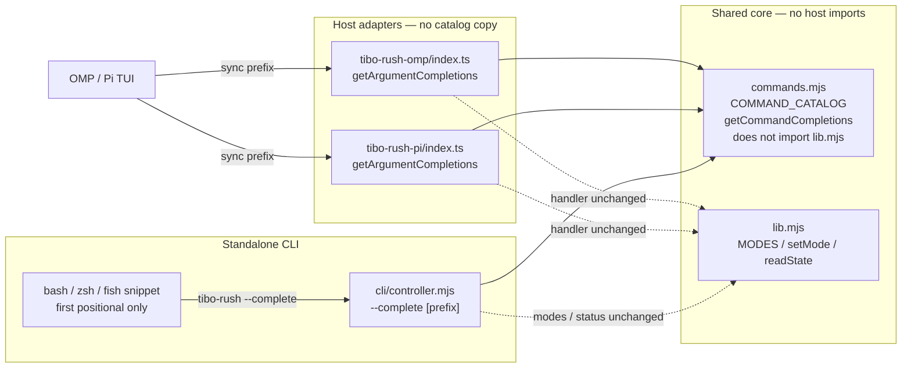

# Tibo Rush slash-command option picker and argument autocomplete

| Field | Value |
| --- | --- |
| **Author** | Tibo Rush maintainers |
| **Date** | 2026-10-26 |
| **Status** | Ready for review |
| **Repo** | https://github.com/happyfeetw/tibo-rush |
| **Tracking issue** | https://github.com/happyfeetw/tibo-rush/issues/12 |
| **Current product version** | 0.2.1 |
| **Target hosts** | Oh My Pi 18.12.5 / 18.12.6, Pi 1.4.0 |
| **Implementation branch** | `feat/command-completions` from `main` |

---

## Overview

`/tibo-rush` currently registers a free-text argument on both Oh My Pi and Pi. Users must type a full token (`regular`, `fast`, `extreme`, `off`, or `status`). There is no TUI dropdown and no shell tab completion. The requested interaction is a slash-command argument picker: after `/tibo-rush ` the host shows a selectable list of those five tokens with short descriptions, filterable by prefix, so the user does not have to memorize or fully type a mode name.

This design adds a **host-agnostic command catalog and synchronous completer** in `src/core/`, wires it into both adapters via the existing `getArgumentCompletions` hook, and exposes the same tokens through `tibo-rush --complete [prefix]` (undocumented as a mode; listed under Options) for git-clone / `bun link` shell users. Mode semantics, restore/`off` contracts, policy files, `state.json`, baselines, and model traffic stay unchanged.

Slash-command handlers still default empty args to `status`. The standalone CLI with no args still prints USAGE and exits 1. Completions are hints; unknown tokens still error.

---

## Background & Motivation

### Current command surface

The same five tokens work on OMP, Pi, and the standalone CLI:

```text
/tibo-rush regular
/tibo-rush fast
/tibo-rush extreme
/tibo-rush off
/tibo-rush status
```

CLI: `tibo-rush <mode>`, `tibo-rush status`, `tibo-rush status --json`.

Modes live in `src/core/lib.mjs`:

```js
export const MODES = ["off", "regular", "fast", "extreme"];
```

`status` is a read-only command, not a mode. Empty **slash-command** args currently default to `status` in both adapters (`const mode = args.trim() || 'status'`). Empty **CLI** argv prints USAGE and `process.exit(1)` (`src/cli/controller.mjs`).

OMP registration today (`src/hosts/tibo-rush-omp/index.ts`, `pi.registerCommand` around line 827) is description + handler only. Pi (`src/hosts/tibo-rush-pi/index.ts`, around line 331) is the same shape. Neither adapter passes `getArgumentCompletions`. The standalone CLI (`src/cli/controller.mjs`) has USAGE text but no completion hook.

### Pain

- Users must recall the exact lowercase token. A typo (`warp`, `Off`, `fastt`) is rejected after submit, not while typing.
- The requested screenshot is the interaction users now expect: space after the command name reveals selectable tokens with short descriptions, arrow-key selection, no need to type the full token.
- Token names and one-line descriptions are already duplicated across adapters, CLI USAGE, and both READMEs. Adding completions without a shared catalog would copy them a fourth and fifth time.

### Host APIs (verified, do not invent others)

**Oh My Pi 18.12.x** (`@oh-my-pi/pi-coding-agent`):

```ts
pi.registerCommand(name: string, options: {
  description?: string;
  getArgumentCompletions?: (argumentPrefix: string) => AutocompleteItem[] | null; // SYNCHRONOUS
  handler: (args: string, ctx: ExtensionCommandContext) => Promise<void>;
}): void;
```

`AutocompleteItem` in `@oh-my-pi/pi-tui` includes `value`, `label`, optional `description`, plus OMP-only extras (`icon`, `hint`, …). **Do not add an npm dependency on `@oh-my-pi/pi-tui`.** Return a structural `{ value, label, description }` object. The OMP adapter currently type-imports only from `@oh-my-pi/pi-coding-agent`.

OMP built-in subcommand completers (`buildArgumentCompletions`) fold case (`argumentPrefix.toLowerCase()` then `s.name.startsWith(lower)`), return `{ value: `${name} `, label: name, description, hint: usage }`, and return `null` once `argumentPrefix.includes(" ")`. Tibo Rush **does not** fold case: `MODES.includes` and the slash handlers are case-sensitive, so `Off` / `FAST` stay hidden **and** rejected. The trailing space on builtin `value` is for commands that expect a *second* argument. `/tibo-rush` takes exactly one token, so this design **does not** copy that trailing space. OMP TUI `applyCompletion` inserts `item.value` as-is (no extra space).

**Pi 1.4.0** (`@earendil-works/pi-coding-agent`):

```ts
getArgumentCompletions?: (argumentPrefix: string) =>
  AutocompleteItem[] | null | Promise<AutocompleteItem[] | null>;
```

Pi 1.4.0 `AutocompleteItem` (`@earendil-works/pi-tui`) is `{ value, label, description? }`. The official example (`examples/extensions/commands.ts`) filters with `startsWith(prefix)` and maps `{ value, label }`. Built-in `/mcp` uses `${item} ` (trailing space) for the first of two tokens. Older Pi TUI crashed on async completers; **keep the function synchronous on Pi as well**, even though the type allows a Promise. Pi argument `applyCompletion` also inserts `item.value` as-is.

Pi 1.4.0 `CombinedAutocompleteProvider.getSuggestions` only runs slash/argument completion when `!options.force && commandText.startsWith("/")`. Explicit Tab (`force`) falls through to path completion. **Space + typing** is the path this design targets. Tab after `/tibo-rush ` may show files, not modes. This design cannot fix the host; README and the checklist must not promise that Tab equals the picker on Pi.

There is no RPC today for “ask the TUI what the dropdown would show.” `scripts/smoke-omp.mjs` and `scripts/smoke-pi.mjs` can assert command *registration* and can invoke `/tibo-rush <token>` as a local command; they cannot drive the interactive picker.

---

## Goals & Non-Goals

### Goals

1. **OMP TUI picker (primary UX).** Typing `/tibo-rush` then space shows a selectable list of `regular | fast | extreme | off | status` with short bilingual descriptions, without requiring Tab. Prefix filters the list. Selecting an item inserts the token. Arrow keys + Enter, matching the requested picker interaction.
2. **Same completer on Pi**, so the two hosts keep one command surface. A recorded Pi 1.4.0 picker checklist is a **merge gate** for any README sentence that names Pi’s picker (this repo’s smoke host `pi` 1.4.0 is installed locally).
3. **Standalone CLI tab completion** of the same tokens via `tibo-rush --complete [prefix]` (undocumented as a mode; listed under Options) and short bash/zsh/fish snippets that complete **only the first positional**. Marketplace installs do not put the CLI on `PATH`; document that.
4. **Single source of truth** for token names and descriptions in shared core. `src/core/commands.mjs` must not import `lib.mjs` or any host API. Completer must be unit-testable with `bun test`.
5. **Behavior unchanged:** slash-command handler empty args → `status`; CLI with no args stays USAGE / exit 1; unknown token → error; `setMode` / reconcile / `off` restore contracts untouched.
6. **Docs:** `README.md` and `README.zh-CN.md` Using-it sections mention the picker and shell completion, including host/install differences and that Tab is host-defined.
7. **GitHub tracking:** issue [#12](https://github.com/happyfeetw/tibo-rush/issues/12) (`enhancement`); one implementation PR from this branch (`Closes #12`); later release PR for marketplace version.

### Non-Goals

- Changing mode semantics, policy schema, `state.json`, baselines, handoffs, or persistent role config.
- Inventing an `omp` native subcommand, a new slash command name, or aliases (`/tibo-rush on`, `/rush`, …).
- Fuzzy / case-insensitive matching, multi-argument completion, or completing `--json` / `--help` in v1.
- Adding `@oh-my-pi/pi-tui` or `@earendil-works/pi-tui` as a runtime or type dependency.
- Automating the TUI dropdown in smoke tests, or claiming Windows/Linux TUI verification.
- Bumping marketplace / package version in the implementation PR.
- Shipping large bash/zsh/fish completion frameworks.
- Using `ctx.ui.select()` / `ctx.ui.custom()` as a *post-submit* picker. The request is argument autocomplete while typing, not a second UI after Enter.
- Network, model, or quota calls of any kind from the completer.
- `argv.includes("--complete")` dispatch, or supporting `--complete=fa`.

---

## Key Decisions

| Decision | Choice | Rationale |
| --- | --- | --- |
| Catalog location | New `src/core/commands.mjs` next to `lib.mjs`. **Must not import `lib.mjs`.** | `lib.mjs` owns state/policy and pulls `fs`. Catalog is UX. Tests import both modules to assert `MODES ⊂ catalog`. Copied by `scripts/package.mjs` (`src/core`). |
| Host coverage | OMP **and** Pi in the same change | `getArgumentCompletions` is available and cheap on both. Splitting would fork the command surface for a 5-token list. |
| Completer shape | Synchronous; `{ value, label, description }`; `null` when nothing matches | Matches OMP’s sync-only hook and Pi 1.4.0 `AutocompleteItem`. Extra OMP fields (`hint`, `icon`) are omitted so we do not depend on `pi-tui`. |
| Completion `value` | Token **without** a trailing space | `/tibo-rush` takes one argument. Both hosts’ `applyCompletion` insert `item.value` as-is. Builtin `` `${name} ` `` is for further args. |
| Empty prefix | Show all five tokens, including `status` | Screenshot behavior. Slash empty *submit* still defaults to `status`; CLI no-args stays USAGE. |
| Prefix match | Case-sensitive `startsWith` | Tokens and `MODES.includes` are case-sensitive. OMP builtins **fold case**; Tibo Rush does not, so `Off` / `FAST` stay hidden and rejected. |
| Second argument | Any whitespace in `argumentPrefix` → `null`. Shell snippets complete first positional only. | One-arg command. CLI `tibo-rush fast extra` is already `Unexpected arguments`. |
| Throw policy | Completer never throws; unknown/non-string/huge prefix → `null` | A throw enters the TUI. Completions are hints; the handler remains the validator. |
| CLI `--complete` dispatch | Strip `--json`, then `args[0] === "--complete"` (not `includes`). Prefix = `args[1] ?? ""`. Do not consult `--help`. Then existing USAGE branch. | Matches `controller.mjs` today. `--complete=fa` is out of scope. |
| CLI flag wording | Undocumented as a mode; listed under Options | Discoverable for shell users without implying it is a mode. |
| Descriptions | Bilingual one-liners, **no bundled model IDs** | Picker text must stay true after `policies.json` edits. Sol/Astra belong in the README preset table, not in the token list. |
| Item order | `regular`, `fast`, `extreme`, `off`, `status` | README command block / user request. Independent of `MODES` (`off` first), which stays a validation set. |
| Versioning | **Minor 0.3.0** in a **follow-up release PR**, not in the feat PR | New user-visible capability, not a restore-contract break. Marketplace users only receive it after release + reinstall/`/restart`. |
| PR split | One implementation PR, then `release: 0.3.0` | Feature is small; over-splitting OMP vs Pi vs CLI is worse than one reviewable PR. |
| Feature flag | None | Completer cannot affect restore/`off`. Worst case the dropdown is empty and users type tokens as today. |
| OMP TUI gate | Recorded picker on **18.12.6** is the merge gate. 18.12.5 preferred if installed; do not claim 18.12.5 TUI verified without a checklist row. | Current `omp --version` is 18.12.6; 18.12.5 is still installed here. |
| Pi TUI gate | Recorded Pi 1.4.0 picker is a merge gate for naming Pi in Using-it | `pi` 1.4.0 is this repo’s smoke host and is installed. API wiring is not a dropdown. |
| Tests | `bun test` on catalog/completer; dedicated `--complete` spawn in `tests/commands.test.mjs` (do **not** reuse `behavior.test.mjs` `cli()`). Manual TUI: OMP 18.12.6 + Pi 1.4.0. | `cli()` always appends `--json` and `JSON.parse`s. TUI picker is not RPC-addressable. Do not claim Windows/Linux TUI verified. |
| Branch name | `feat/command-completions` | Change covers OMP, Pi, and CLI, not OMP only. |

---

## Proposed Design

### Architecture



`commands.mjs` does **not** import `lib.mjs`. Core still does not import `@oh-my-pi/*` or `@earendil-works/*`. Adapters still do not import each other. `MODES` remains the validation set for `setMode` / `policyFor` / `state.json`. The catalog is the UX list (`MODES` + `status`) and must not be used to invent a sixth mode. The `MODES ⊂ catalog` invariant is enforced in `tests/commands.test.mjs` by importing both modules, not at catalog import time.

### Command catalog

New file: `src/core/commands.mjs`. Hard-code the five rows. **Do not** `import` from `./lib.mjs` (that would evaluate the state/policy module and `fs` on every TUI keystroke module graph, and would contradict “completer does not import `readState` / `setMode`”).

Recommended user-facing copy (exact strings for the TUI `description` field and for tests):

| `value` (= `label`) | `description` |
| --- | --- |
| `regular` | `日常档 / Everyday preset` |
| `fast` | `冲刺档 / Sprint preset` |
| `extreme` | `冲刺档 + Fast（priority） / Sprint + Fast (priority)` |
| `off` | `恢复入档前状态 / Restore pre-mode setup` |
| `status` | `只读状态 / Read-only status` |

Rationale for this copy:

- Bilingual, matching CLI USAGE and the two READMEs.
- Short enough for a TUI dropdown row (one label + one description per row).
- Does **not** mention Sol / Astra / GPT-6. Those are bundled-preset examples in `presets/tibo-rush.json` and can be overridden in `~/.tibo-rush/policies.json`.
- `off` says “pre-mode setup”, which is the real restore contract (per-session baseline, not “reset to Sol”).
- `status` is labeled read-only so it is not mistaken for a mode.

Slash-command *registration* descriptions stay host-specific and English, because they document capability limits rather than token meaning:

- OMP: `Global Tibo Rush configurable presets: regular | fast | extreme | off | status`
- Pi: `Global Tibo Rush: regular | fast | extreme | off | status (Pi has no OMP role routing)`

Do not move those strings into the catalog.

Illustrative module (implementation may match this shape; not a mandate to paste blindly):

```js
/** @typedef {{ value: string, label: string, description: string }} CommandCompletion */

/** @type {CommandCompletion[]} */
export const COMMAND_CATALOG = [
  { value: "regular", label: "regular", description: "日常档 / Everyday preset" },
  { value: "fast",     label: "fast",     description: "冲刺档 / Sprint preset" },
  { value: "extreme",  label: "extreme",  description: "冲刺档 + Fast（priority） / Sprint + Fast (priority)" },
  { value: "off",      label: "off",      description: "恢复入档前状态 / Restore pre-mode setup" },
  { value: "status",   label: "status",   description: "只读状态 / Read-only status" },
];

export const COMMAND_VALUES = COMMAND_CATALOG.map((item) => item.value);

/**
 * Synchronous argument completer for `/tibo-rush` and `tibo-rush --complete`.
 * Never throws. Returns null when the host should hide the list.
 *
 * @param {unknown} argumentPrefix
 * @returns {CommandCompletion[] | null}
 */
export function getCommandCompletions(argumentPrefix) {
  try {
    if (typeof argumentPrefix !== "string") return null;
    if (/\s/.test(argumentPrefix)) return null;
    const items = COMMAND_CATALOG
      .filter((item) => item.value.startsWith(argumentPrefix))
      .map((item) => ({ value: item.value, label: item.label, description: item.description }));
    return items.length > 0 ? items : null;
  } catch {
    return null;
  }
}
```

`COMMAND_VALUES` is a convenience export for tests. Catalog ↔ `MODES` consistency is **not** asserted at import in production.

Invariant tests in `tests/commands.test.mjs` (import `COMMAND_VALUES` / `COMMAND_CATALOG` from `commands.mjs` **and** `MODES` from `lib.mjs`; not runtime asserts on the TUI path):

- `COMMAND_VALUES` is `["regular", "fast", "extreme", "off", "status"]`.
- `MODES.every((m) => COMMAND_VALUES.includes(m))`.
- `status` is in the catalog and `'status' ∉ MODES`.
- Every `value === label`, no trailing whitespace, no empty description.

Do **not** change `MODES` order in `lib.mjs`.

### Completer contract

| Input `argumentPrefix` | Output |
| --- | --- |
| `""` | all five items, catalog order |
| `"f"` | `[{ value: "fast", … }]` |
| `"fast"` | `[{ value: "fast", … }]` |
| `"ex"` | `[{ value: "extreme", … }]` |
| `"z"` | `null` |
| `"fast "` / `"fast extra"` / `"fast\t"` | `null` |
| `"Off"` / `"FAST"` | `null` (OMP builtins would fold case; we do not) |
| `null` / `undefined` / `1` | `null` (no throw) |
| `"a".repeat(1e6)` (1 MiB) | `null` (no throw; unit test only, not TUI) |

`value` is exactly `regular` / `fast` / `extreme` / `off` / `status` — never `` `${name} ` ``.

Call frequency: once per keystroke in the TUI. The function is a pure filter over five frozen objects. Target: well under 1 ms on normal prefixes; the 1 MiB case must return `null` without throwing in a few milliseconds. Zero I/O, zero `process.env`, zero `fs`, zero `fetch`. It must not import `lib.mjs` and must not call `readState`, `policyFor`, `listClients`, or `setMode`.

### Adapter wiring

OMP (`src/hosts/tibo-rush-omp/index.ts`) and Pi (`src/hosts/tibo-rush-pi/index.ts`):

```ts
import { getCommandCompletions } from '../../core/commands.mjs';

pi.registerCommand('tibo-rush', {
  description: /* existing host-specific string, unchanged */,
  getArgumentCompletions: getCommandCompletions,
  handler: async (args, ctx) => { /* existing body, unchanged */ },
});
```

Handler body stays as-is:

```ts
const mode = args.trim() || 'status';
if (mode === 'status') { /* read-only notify */ return; }
if (!MODES.includes(mode)) throw new Error('Use regular, fast, extreme, off or status');
await setMode(mode);
// enqueue / notify …
```

Do not wrap the completer in `async`. Do not `await` it. If a future refactor adds a wrapper, it must still return `AutocompleteItem[] | null` synchronously.

Pi still does not apply OMP role routing; that stays under “What each host actually changes.” Completions do not claim otherwise. README may name Pi’s picker only after the Pi 1.4.0 checklist is recorded (merge gate).

### Empty-args vs empty-prefix

These are different events, and CLI empty argv is a third:

| Surface | Empty input | Behavior (unchanged) |
| --- | --- | --- |
| Slash `/tibo-rush` with no argument, submitted | `args.trim() === ""` | **status** (read-only) |
| Slash `/tibo-rush ` while typing (not submitted) | completer prefix `""` | show all five tokens, including `status` |
| CLI `tibo-rush` with no args | `args.length === 0` | **USAGE, exit 1** |

```mermaid
sequenceDiagram
  participant U as User
  participant T as OMP/Pi TUI
  participant C as getCommandCompletions
  participant H as slash handler
  U->>T: type "/tibo-rush "
  T->>C: argumentPrefix ""
  C-->>T: five items (incl. status)
  Note over T: dropdown visible; nothing submitted
  alt User presses Enter with no token
    T->>H: args ""
    H-->>U: status (read-only)
  else User arrows to fast, Enter, Enter
    T->>H: args "fast"
    H-->>U: setMode("fast") + reconcile
  else User types warp, Enter
    T->>H: args "warp"
    H-->>U: error, no state write
  end
```

Completer showing `status` does **not** change the slash empty-submit default. Do **not** change the CLI so that no-args becomes `status`.

### Standalone CLI: `--complete`

`src/cli/controller.mjs` gains `--complete` as a first-token flag after the existing `--json` strip. It is **undocumented as a mode** and **listed under Options**. It never calls `readState` / `setMode`.

Exact dispatch, matching current `run()` structure. Implement this order; do not invent a raw-`argv[0]` check that runs before the `--json` filter, and do not use `argv.includes("--complete")` / `args.includes("--complete")` anywhere:

```js
async function run(argv) {
  const jsonMode = argv.includes("--json"); // unused on the --complete path
  const args = argv.filter((a) => a !== "--json");

  if (args[0] === "--complete") {
    const prefix = args[1] ?? "";
    // ignore args.slice(2); do not consult --help / -h
    const items = getCommandCompletions(prefix) ?? [];
    for (const item of items) console.log(item.value);
    return; // exit 0 via main(); stdout is tokens, never JSON
  }

  if (args.length === 0 || args.includes("--help") || args.includes("-h")) {
    console.log(USAGE.trim());
    process.exit(args.length === 0 ? 1 : 0);
  }

  // existing status / MODES lookup unchanged
}
```

Worked examples:

| argv | After stripping `--json` | Result |
| --- | --- | --- |
| `--complete` | `["--complete"]` | all five tokens, exit 0 |
| `--json --complete` | `["--complete"]` | all five tokens, exit 0 (not JSON) |
| `--complete --json` | `["--complete"]` | all five tokens, exit 0 (`--json` stripped before prefix is taken) |
| `--complete --help` | `["--complete", "--help"]` | prefix `"--help"` → empty stdout, exit 0 (**not** USAGE) |
| `--help --complete` | `["--help", "--complete"]` | USAGE, exit 0 (`args[0]` is not `--complete`) |
| `fast --complete` | `["fast", "--complete"]` | `Unexpected arguments: --complete` (not `includes`) |
| `--complete=fa` | `["--complete=fa"]` | `Unknown command or mode: --complete=fa` — **out of scope**; do not parse `=` |

Behavior of a successful `--complete` path:

- Print matching `value`s, one per line, UTF-8, no extra decoration.
- Missing prefix ≡ `""` ≡ print all five tokens in catalog order.
- Zero matches: exit 0, empty stdout (shell completion convention).
- Extra argv after the prefix is ignored; do not throw `USAGE`.
- `--json` is stripped before the prefix is taken, so it never becomes the prefix and never switches stdout to JSON.
- Must not create `~/.tibo-rush`, must not read `state.json` / policies.
- Exit non-zero only on unexpected fatal errors (same as today’s `FATAL` path). A completer `null` is not an error.

USAGE: add one line under Options so shell users can find it, without listing it as a mode:

```text
  --complete [prefix]                     打印匹配的档位 token，供 shell 补全 / print matching tokens for shell completion
```

`--completion-script bash` generators are **out of scope**. A generator is more magic than a 10-line snippet, and marketplace users still would not have the binary on `PATH`.

#### Shell snippets (README, copy-paste)

Document that these require a git checkout or `bun link` so `tibo-rush` is on `PATH`. Marketplace / `omp plugin install` / `pi install` do **not** install the CLI.

Snippets must complete **only the first positional**. They must not complete `--json`, `--help`, or a second word. Empty-prefix ≡ all five tokens is correct for that first argument; calling `--complete ""` on `tibo-rush fast <Tab>` would offer another mode that the CLI then rejects (`Unexpected arguments`).

**zsh** (primary; this repo’s host acceptance is macOS). `words[1]` is the command; `CURRENT == 2` is the first argument:

```zsh
# ~/.zshrc — requires `tibo-rush` on PATH (git clone + bun link)
_tibo_rush() {
  (( CURRENT == 2 )) || return
  local -a tokens
  tokens=(${(f)"$(tibo-rush --complete "${words[CURRENT]-}")"})
  compadd -- "${tokens[@]}"
}
compdef _tibo_rush tibo-rush
```

**bash:** keep `COMP_CWORD -eq 1` (first argument; `COMP_WORDS[0]` is the command):

```bash
# ~/.bashrc
_tibo_rush() {
  local cur="${COMP_WORDS[COMP_CWORD]}"
  if [ "$COMP_CWORD" -eq 1 ]; then
    COMPREPLY=()
    local token
    while IFS= read -r token; do
      [ -n "$token" ] && COMPREPLY+=("$token")
    done < <(tibo-rush --complete "$cur")
  fi
}
complete -F _tibo_rush tibo-rush
```

**fish:** first argument only (`__fish_is_first_token`; if a given fish lacks it, use an equivalent first-argument-only predicate such as `__fish_use_subcommand` or `test (count (commandline -opc)) -eq 1`):

```fish
complete -c tibo-rush -f -n '__fish_is_first_token' -a "(tibo-rush --complete (commandline -ct))"
```

Do not add `contrib/` scripts in v1. That would force a `package.json` `files` / `scripts/package.mjs` decision for a 10-line snippet. README is enough. Revisit contrib files only if users ask for packaged completions after 0.3.0.

### Handler remains the source of truth

Completions are hints. Typing `/tibo-rush warp` still throws `Use regular, fast, extreme, off or status` and does not write `state.json` (already covered by `tests/behavior.test.mjs` “invalid mode never creates or replaces a request”). The completer must not pre-validate against live state (e.g. hiding `extreme` when policy is broken): `setMode("extreme")` already rejects a bad policy, and hiding the token would pretend the mode does not exist.

---

## API / Interface Changes

### Host extension API (OMP + Pi)

Additive optional field on the existing `registerCommand('tibo-rush', …)` call:

| Field | Before | After |
| --- | --- | --- |
| `description` | host-specific string listing tokens | **unchanged** |
| `handler` | slash: trim → status / `MODES` / `setMode` | **unchanged** (slash empty args still `status`) |
| `getArgumentCompletions` | absent | `getCommandCompletions` from `src/core/commands.mjs` |

No new slash command. No change to `/restart` (OMP) or `/reload` (Pi) requirements beyond “existing sessions must reload extension code to pick up the new hook.”

### CLI

The API table is the source of truth for empty CLI argv (USAGE, exit 1). Slash empty args → status is a **host handler** fact, not a CLI fact.

| Invocation | Before | After |
| --- | --- | --- |
| `tibo-rush <mode>` | set requested mode | unchanged |
| `tibo-rush status` | read-only | unchanged |
| `tibo-rush` (no args) | USAGE, exit 1 | **unchanged** (not status) |
| `tibo-rush --help` | USAGE | USAGE plus `--complete` line under Options |
| `tibo-rush --complete` | `Unknown command or mode: --complete`, exit 1 | print five tokens, exit 0 |
| `tibo-rush --complete fa` | same error | print `fast` |
| `tibo-rush --json --complete` | unknown mode | five tokens, not JSON |
| `tibo-rush --complete --json` | prefix would have been `--json` if `--json` were not stripped | five tokens, not JSON |
| `tibo-rush --complete --help` | USAGE if help ran first | empty stdout if prefix `--help` does not match; **not** USAGE |
| `tibo-rush fast --complete` | `Unexpected arguments` | **unchanged** (`--complete` is not `includes`) |
| `tibo-rush --complete=fa` | unknown mode | **unchanged** / out of scope |

### Types

No `state.json` / `RushState` / `RushClient` change. Optional JSDoc typedef in `commands.mjs` is enough; do not expand `src/core/types.ts` unless a TS adapter needs a named type. Adapters should keep using the inferred `{ value, label, description }[] | null`.

---

## Data Model Changes

**None.** No migration. `state.json` stays `{ version: 1, mode, revision, updatedAt }`. Completions do not persist. Existing sessions keep their requested mode; they only need `/restart` (OMP) or `/reload` (Pi) to load the new extension source. Mode/revision do not migrate.

`scripts/package.mjs` already copies the whole `src/core` tree, so `commands.mjs` is included in both `tibo-rush-omp-*.tgz` and `tibo-rush-pi-*.tgz` without a packaging whitelist change.

Root `package.json` `"files"` already includes `src/`. CI `npm pack --dry-run` file count will increase by one (`src/core/commands.mjs`). That is expected and should be asserted in the PR description, not treated as a packing regression.

---

## Alternatives Considered

### 1. Post-submit `ctx.ui.select()` picker instead of `getArgumentCompletions`

After `/tibo-rush` with empty args, open a select widget.

- **Pros:** Works even if argument completions are flaky; one extra UI.
- **Cons:** Changes slash empty-args semantics (today: status). Does not match the screenshot (inline dropdown while typing). Requires TUI-only handler branches (`ctx.mode !== "tui"`). RPC/smoke paths that send `/tibo-rush` with no args would block on UI. **Rejected.**

### 2. Copy token lists into each adapter + CLI

- **Pros:** Zero new core file.
- **Cons:** Five copies (OMP, Pi, CLI, two READMEs already exist). Drifts immediately. Harder to unit-test without importing host packages (adapters cannot be imported in `bun test` — they depend on `@oh-my-pi/pi-coding-agent` / `@earendil-works/pi-coding-agent`, which this repo does not vendor). **Rejected.**

### 3. Defer Pi; ship OMP-only

- **Pros:** Smaller first PR; OMP is the screenshot host.
- **Cons:** The product invariant is one command surface on peer adapters. Pi 1.4.0 already has the hook and the same `{ value, label }` example. Deferral would need a README “Pi has no picker” line that would be a lie about the API and a second PR for ten lines. **Rejected.** Pi TUI recording is a merge gate for *naming* Pi in Using-it, not a reason to omit the hook.

### 4. Trailing space on `value` like OMP builtins / Pi `/mcp`

- **Pros:** Matches host built-in subcommand style.
- **Cons:** Those commands take further arguments. `/tibo-rush` does not. Both hosts insert `item.value` as-is. **Rejected.**

### 5. Ship three full completion scripts under `contrib/` and add `tibo-rush --completion-script`

- **Pros:** `eval "$(tibo-rush --completion-script zsh)"` is convenient.
- **Cons:** Packaging questions (`files`, host tarballs, marketplace). Marketplace users still lack the binary. User asked to avoid huge scripts when a snippet plus helper is enough. **Deferred** past 0.3.0 unless requested.

### 6. Case-insensitive / fuzzy match

- **Pros:** Nicer for `Fast` / `exterme`. Matches OMP builtin case folding.
- **Cons:** Handler stays case-sensitive. A dropdown that offers `fast` for `Fast` then submits `Fast` would still error unless we also rewrite the buffer. Fuzzy ranking is extra code for five tokens. **Rejected** for v1.

### 7. Import `MODES` into `commands.mjs` for a runtime invariant

- **Pros:** Catalog cannot drift from `lib.mjs` without a load-time failure.
- **Cons:** Evaluates the state/policy module (`fs`, `os`, `process`) on the completer’s module graph. Points the dependency the wrong way. Tests can import both modules instead. **Rejected.**

---

## Security & Privacy Considerations

| Threat | Severity | Mitigation |
| --- | --- | --- |
| Completer throws into the TUI and breaks input | High | `try/catch` → `null`. Tests pass non-strings, whitespace, and a 1 MiB prefix. |
| Completer reads or writes `state.json` / policies / baselines | High (contract) | `commands.mjs` does not import `lib.mjs`. `--complete` returns after printing tokens, before any core I/O. Tests assert `--complete` does not create files under a private `TIBO_RUSH_HOME`. |
| Completer triggers model / network / quota | High (policy + billing) | No `fetch`, no host `setModel`. Smoke already denies network; do not weaken that. Completer is offline by construction. |
| Prefix echoed into shell completion → injection | Medium | `--complete` prints **catalog values only**, never the raw prefix. Snippets must not `eval` that output. README snippets use `compadd` / `COMPREPLY` arrays. |
| Screenshot/GIF of the picker leaks a personal session | Medium | Record in a throwaway demo project, no paid model calls, same rule as existing README GIFs. |
| New file executed inside the host process | Low (already true of adapters) | No new trust boundary. Catalog is static strings. Still not a sandbox — existing SECURITY.md applies. |

No new PII. No telemetry. Completions do not log keystrokes (a per-keystroke log would leak the buffer and add latency).

---

## Observability

This is a local, synchronous, per-keystroke filter. **Do not log, metric, or trace completions.**

- Success: dropdown appears; no log line.
- No matches: host hides the list (`null`); no log line.
- Unexpected exception: swallowed to `null`; still no log (logging from the TUI thread is the wrong place to discover a bug — unit tests are).

If a future debug flag is needed, it belongs on the CLI (`tibo-rush --complete` is already inspectable) and must stay off the TUI path.

CI already runs `bun test` and `npm pack --dry-run` on PRs (`.github/workflows/ci.yml`). No new workflow. Real-host smoke stays manual/local with `OMP_BIN` / `PI_CLI_JS`.

---

## Rollout Plan

### Feature flag

None. The hook is additive. If `getArgumentCompletions` is missing or returns `null`, the user types tokens as in 0.2.1. Restore/`off` cannot regress because those code paths are not touched.

### Staged delivery

1. **Design accepted** (this document).
2. **GitHub issue** (`enhancement`) — paste the draft in “GitHub tracking” below. Do not open it from this design step.
3. **Implementation PR** on `feat/command-completions` from **`main`** (not from `docs/zh-readme-icon`). `Closes #12`.
4. **Manual macOS TUI checklist:** recorded picker on **OMP 18.12.6** is the merge gate; **18.12.5** if that binary is installed (preferred here; do not claim 18.12.5 TUI verified without a checklist row). **Pi 1.4.0** recorded picker is a merge gate for naming Pi in Using-it.
5. **Merge to `main`.** Git/dev users who load the extension from a checkout pick it up after `/restart` or `/reload`. Marketplace users **do not** see it yet.
6. **Follow-up `release: 0.3.0` PR** bumps `package.json`, `.omp-plugin/marketplace.json`, and README version pins (`tibo-rush-*-0.2.1.tgz`, `pi install …@v0.2.1`). Then tag, `bun run pack:hosts`, marketplace reinstall + `/restart`.

### Existing sessions

| Install | How to load new extension code | State migration |
| --- | --- | --- |
| OMP marketplace / plugin | `/restart` per open session | None. Requested mode unchanged. |
| Pi git/package | `/reload` or quit + resume | None. |
| Standalone CLI (`bun link` / `bin/tibo-rush.mjs`) | next process start | `--complete` available immediately; no state I/O. |

### Rollback

- Revert the feat PR (or reinstall `tibo-rush-omp@0.2.1` / `tibo-rush-pi` at `v0.2.1`) and `/restart` or `/reload`.
- Users can always type the tokens; a bad completer that returns `null` is already the 0.2.1 UX.
- Never roll back by deleting `state.json`, `clients/`, or `baselines/`.

### Versioning rationale (patch vs minor)

Recommend **minor `0.3.0`**, not `0.2.2`:

- Semver (even in 0.x as used by this repo’s `release: 0.2.1`): new user-visible capability and a new CLI flag.
- Not a major: restore/`off` contracts, policy schema, and command names are unchanged.
- Not a patch: this is the interaction change users will notice, not a bugfix.

The **feat PR must not bump** `package.json` / marketplace `version`. Shipping UX to marketplace users requires a deliberate release plus reinstall. Mixing a release with the feature makes review and revert harder.

---

## Verification

### Unit tests (`bun test`)

Add `tests/commands.test.mjs` (keep `tests/behavior.test.mjs` focused on state/policy). Import `COMMAND_CATALOG` / `COMMAND_VALUES` / `getCommandCompletions` from `../src/core/commands.mjs` and `MODES` from `../src/core/lib.mjs`. Suggested cases:

1. Catalog order and exact bilingual descriptions (table above).
2. `MODES.every((m) => COMMAND_VALUES.includes(m))`; `'status' ∉ MODES`; `status` is in the catalog.
3. `value === label`; no trailing space on `value`.
4. Empty prefix → five items.
5. `"f"` → only `fast`; `"ex"` → only `extreme`; `"off"` → only `off`.
6. No match (`"z"`, `"warp"`, `"Fast"`) → `null`.
7. Any whitespace (`"fast "`, `"a b"`, `"\t"`) → `null`.
8. Non-string (`undefined`, `null`, `0`, `{}`) → `null`, does not throw.
9. 1 MiB prefix `"a".repeat(1e6)` → `null`, does not throw, finishes in a few milliseconds. Keep this off the TUI path.
10. Return value is `null` or a plain array, not a Promise.
11. Completer does not import `lib.mjs` (by construction of `commands.mjs`). `--complete` process tests assert no files are created under a private `TIBO_RUSH_HOME`.

Invalid-mode coverage (`warp` does not write state) stays in `tests/behavior.test.mjs` as today.

### CLI `--complete` process tests

Put these in `tests/commands.test.mjs` with a **dedicated spawn**. Do **not** reuse `tests/behavior.test.mjs` `cli()`: that helper always appends `--json` and `JSON.parse`s stdout/stderr, so `cli(dir, "--complete")` would throw on `regular\nfast\n…`.

```js
async function complete(dir, ...args) {
  const child = Bun.spawn(
    [process.execPath, path.join(root, "src/cli/controller.mjs"), ...args],
    {
      cwd: dir,
      env: { PATH: process.env.PATH, HOME: dir, TMPDIR: dir, TIBO_RUSH_HOME: dir },
      stdout: "pipe",
      stderr: "pipe",
    },
  );
  const [stdout, stderr, code] = await Promise.all([
    new Response(child.stdout).text(),
    new Response(child.stderr).text(),
    child.exited,
  ]);
  return { code, stdout, stderr };
}
```

Cases (stdout is raw text, never `JSON.parse`’d):

- `complete(dir, "--complete")` → exit 0, stdout is the five tokens in catalog order, stderr empty, `readdir(dir)` unchanged (no `state.json`).
- `complete(dir, "--complete", "fa")` → `fast\n`.
- `complete(dir, "--complete", "z")` → empty stdout, exit 0.
- `complete(dir, "--json", "--complete")` and `complete(dir, "--complete", "--json")` → five tokens, stdout does not contain `{`, exit 0 (locks the strip-`--json`-then-`args[0]` order).
- `complete(dir, "--complete", "--help")` → empty stdout (prefix `--help` does not match), exit 0, **not** USAGE.
- `complete(dir, "--complete=fa")` → exit 1, unknown mode (out of scope; not parsed as prefix `fa`).
- `--help` (existing human USAGE) still lists `regular|fast|extreme|off|status` and mentions `--complete` under Options. Use a spawn **without** automatic `--json`; do not route this through `cli()`.

Do **not** spawn an interactive zsh to test `compadd`. The function `--complete` is the testable unit; snippets are documentation.

### Real-host smoke (unchanged automation)

`OMP_BIN=/absolute/path/to/omp bun run smoke` and `PI_CLI_JS=/absolute/path/to/pi-cli.js bun run smoke:pi` already:

- Assert `/tibo-rush` is registered as an extension command.
- Invoke `/tibo-rush regular|fast|extreme|off|status` as local commands with network denied.

Keep that. Optionally, after registration, the smoke could import `getCommandCompletions` and re-run the unit matrix inside the smoke process — that duplicates `bun test` and is **not** required.

Do not add a TUI driver. There is no verified RPC for argument completions.

### Manual acceptance checklist (required for the feat PR)

Record pass/fail. Host acceptance remains **macOS only**. Do not claim Windows/Linux TUI verified.

**OMP 18.12.6 — merge gate** (throwaway project, no paid model calls, no personal session). Current `omp --version` here is 18.12.6.

**OMP 18.12.5 — preferred if installed** (it is, in this environment). Same checklist as its own row. Do not claim 18.12.5 TUI verified without that row.

1. Load the branch (`omp plugin link` or `--extension` on the checkout). `/restart`.
2. Type `/tibo-rush` then **space**. The list appears **without requiring Tab**. Dropdown shows five rows in catalog order, each with the bilingual description.
3. Arrow keys move; Enter inserts the token **without** a trailing space. A second Enter runs the handler.
4. Type `/tibo-rush f` → only `fast`. Enter inserts `fast`.
5. Type `/tibo-rush z` → list hidden / empty. Typing `warp` and Enter still errors; `state.json` unchanged.
6. Type `/tibo-rush` and Enter with no argument → `status` notify, no mode write. (Slash empty args, not CLI.)
7. Confirm no model request / no network (status line, no assistant turn).
8. `off` still restores (existing smoke covers this; a quick manual `fast` then `off` is enough if smoke is also run).
9. Optional observation, not a gate: Tab after `/tibo-rush ` may follow the host’s Tab binding. Do not fail the PR if Tab does not open the picker.

**Pi 1.4.0 — merge gate for naming Pi in Using-it** (`pi` 1.4.0 is this repo’s smoke host and is installed). Same steps 1–8 after `/reload`, with step 2 especially: list appears after space **without requiring Tab**. Do not promise or require that Tab equals the picker (Pi 1.4.0 `force` Tab skips slash-argument completions and may show files). If this checklist is skipped, the README must **not** say Pi opens the argument picker; that would violate `Agents.md` (do not claim unverified host TUI behavior). This design recommends **not** skipping it.

**CLI (git clone):**

```sh
bun bin/tibo-rush.mjs --complete
bun bin/tibo-rush.mjs --complete fa
```

### Packaging

- `npm pack --dry-run` includes `src/core/commands.mjs`.
- `bun run pack:hosts` both tarballs contain `src/core/commands.mjs`.
- Host tarballs still exclude `tests/`, `scripts/`, `state.json`.

---

## Documentation changes

Update **Using it** in both READMEs (`README.md` § Using it, `README.zh-CN.md` § 使用). Keep host capability differences where they already live.

Because Pi 1.4.0 picker recording is a merge gate, Using-it **may** name both hosts. Prefix/space opens the host argument picker; **Tab behavior is the host’s** and is not promised to equal the picker (especially on Pi).

English (insert after the command block / “From a terminal…”):

> In Oh My Pi, and in Pi when the host shows slash-command argument completions, type `/tibo-rush` and a space to open the argument picker (`regular`, `fast`, `extreme`, `off`, `status`). You do not have to press Tab for the list to appear. Arrow keys select a token; you do not have to type the full name. Prefix text filters the list. Tab after the command is defined by the host (on Pi it may complete files instead). Submitting `/tibo-rush` with no argument still prints status. The standalone CLI with no arguments still prints usage and exits 1.
>
> The standalone CLI (`git clone` / `bun link`) can tab-complete the same tokens if `tibo-rush` is on your `PATH`. Marketplace installs do not put the CLI on `PATH`. Enable completion with the snippets below (first argument only; they do not complete `--json` or a second word). `tibo-rush --complete [prefix]` is listed under Options for those snippets; it is not a mode and does not change mode.

The first sentence names Pi because the Pi checklist is a merge gate. If implementation later skips Pi recording, that sentence must be rewritten to OMP-only before merge — do not ship “and Pi” on API wiring alone.

Chinese:

> 在 Oh My Pi，以及会显示斜杠命令参数补全的 Pi 里，输入 `/tibo-rush` 再按空格会弹出档位列表（`regular`、`fast`、`extreme`、`off`、`status`），不必先按 Tab。可用方向键选择，不必手打完整名字。已输入的前缀会过滤列表。命令后的 Tab 由宿主决定（Pi 上可能补全文件）。不带参数直接回车仍是 `status`。独立 CLI 不带参数仍打印用法并以状态码 1 退出。
>
> 独立 CLI（git clone / `bun link`）在 `tibo-rush` 位于 `PATH` 时可用 Tab 补全同一组 token。市场安装不会把 CLI 放进 `PATH`。启用方式见下方片段（只补全第一个参数，不补全 `--json` 或第二个词）。`tibo-rush --complete [prefix]` 写在 Options 里给这些片段用，它不是档位，不会改模式。

Then the three shell snippets from above (zsh `CURRENT == 2`, bash `COMP_CWORD -eq 1`, fish `__fish_is_first_token`).

Do **not** add a new README GIF in the feat PR unless a throwaway recording is already in hand. Existing switch GIFs remain valid; the picker is a typing affordance, not a mode-switch demo. A follow-up docs PR can add a picker GIF (same rules: isolated project, no paid model calls).

Development tree in both READMEs can mention `src/core/commands.mjs` only if we keep the tree one-level (`src/core/` already covers it). No structural README change required.

---

## GitHub tracking and PR workflow

Tracking issue is already open: [#12](https://github.com/happyfeetw/tibo-rush/issues/12) (`enhancement`). Do not reuse #10 (unrelated Chinese README work). The issue body matches the #10 template:

### Issue (one, `enhancement`)

- **Title:** `feat: slash-command option picker and CLI autocomplete for tibo-rush`
- **Labels:** `enhancement`
- **Not** `documentation` as the primary label (docs ride along).
- **Body** (already filed on #12):

```markdown
## Summary

`/tibo-rush` takes a free-text argument. Users want a slash-command argument picker: after `/tibo-rush ` a selectable list of `regular | fast | extreme | off | status` with short descriptions, plus the same tokens on CLI tab completion.

## Goal

- OMP 18.12.x TUI argument picker via `getArgumentCompletions` (sync). Recorded picker on 18.12.6 is the merge gate.
- Same hook on Pi 1.4.0 so the command surface stays one. Recorded Pi picker is a merge gate for naming Pi in Using-it.
- Shared catalog + completer in `src/core/commands.mjs` (does not import `lib.mjs`), unit-tested with `bun test`.
- `tibo-rush --complete [prefix]` (undocumented as a mode; listed under Options) for git-clone / `bun link` shell completion. First positional only.
- README.md and README.zh-CN.md Using-it notes, including “marketplace does not put the CLI on PATH” and that Tab is host-defined.
- Slash-command empty args → status. CLI no-args stays USAGE / exit 1. restore/`off`, policies, and `state.json` unchanged.

## Plan

- Branch `feat/command-completions` from `main`.
- Implement catalog, completer, adapter wiring, CLI flag (strip `--json`, then `args[0] === "--complete"`), tests, README.
- `bun test`; `npm pack --dry-run`; `bun run pack:hosts`.
- Manual macOS TUI checklist: OMP 18.12.6 (gate), 18.12.5 if installed; Pi 1.4.0 (gate for naming Pi).
- Single implementation PR; `Closes #12`. No version bump in that PR.

## Out of scope

- Marketplace / package version (follow-up `release: 0.3.0`).
- Mode semantics, restore contracts, policy schema.
- Windows/Linux TUI claims.
- Fuzzy matching, `ctx.ui.select` post-submit picker, contrib completion scripts.
- `--complete=fa`; `argv.includes("--complete")`.
```

### Branch

- From **`main`**, not `docs/zh-readme-icon`.
- Name: `feat/command-completions`.

### Implementation PR

- **Title:** `feat: add /tibo-rush argument completions on OMP, Pi, and CLI`
- **Labels:** `enhancement`
- **Body must include:** `Closes #12`, test plan, file list, manual checklist results (OMP 18.12.6 required; 18.12.5 row if installed; Pi 1.4.0 required to keep Pi in Using-it), optional picker screenshot/GIF from a throwaway demo (no personal session, no paid model calls).
- **Review gates:** `bun test` green; `npm pack --dry-run`; `bun run pack:hosts`; recorded OMP **18.12.6** picker checklist; recorded **Pi 1.4.0** picker checklist if Using-it names Pi (it should). CI does not replace those checklists.
- Small, focused, English title — matches `docs: …`, `release: 0.2.1`.

### Release PR (after the feat PR is on `main`)

- **Title:** `release: 0.3.0`
- Bump `package.json` `version`, `.omp-plugin/marketplace.json` `metadata.version` and plugin `version`, README version pins (`v0.2.1`, tarball names).
- Tag, pack, marketplace reinstall smoke. Not part of the feat PR.

---

## Open Questions

None that should block implementation. Defaults above are the plan unless the maintainer overrides them:

| Topic | Default if no reply |
| --- | --- |
| Description language | Bilingual one-liners in the table under Command catalog |
| Include Pi in the same PR | Yes; recorded Pi 1.4.0 picker is a merge gate for naming Pi in Using-it |
| Version | 0.3.0 in a later release PR; feat PR does not bump |
| Shell scripts | README snippets only; no `contrib/`; first positional only |
| Trailing space on `value` | No |
| Slash empty submit | Still `status` |
| CLI no-args | Still USAGE / exit 1 |
| Picker GIF in feat PR | Optional; do not block merge |
| OMP TUI gate | 18.12.6 recorded; 18.12.5 preferred if installed |
| `--complete=fa` | Out of scope |

If the maintainer wants Chinese-only TUI descriptions, swap the `description` column to the Chinese clause before the slash (`日常档`, `冲刺档`, …) and keep English in the README. Do not mix that change with a catalog split per host.

---

## Risks

| Risk | Severity | Mitigation |
| --- | --- | --- |
| OMP `getArgumentCompletions` is sync-only; an accidental `async` wrapper breaks or no-ops the dropdown | High | Export a non-async function. Tests: return value is `null` or a plain array, not a Promise. |
| Throw from completer takes down TUI input | High | `try/catch` → `null`. Fuzz non-strings and a 1 MiB prefix in unit tests. |
| Trailing-space copy-paste from OMP builtins | Medium | Unit test `value.endsWith(" ")` is false. Manual checklist step 3. |
| Adapter-only copy of tokens drifts from CLI | Medium | Single module; tests import `lib.mjs` `MODES` and catalog separately. |
| Marketplace users expect Tab completion inside OMP’s *shell* | Low | README states marketplace does not install the CLI; the TUI picker is the marketplace UX. |
| README claims Pi picker without a recorded dropdown | Medium | Pi 1.4.0 checklist is a merge gate for that sentence. |
| Pi Tab (`force`) shows files, users think the feature is broken | Low | README + checklist: list appears after space; Tab is host-defined. |
| `--complete` parsed with `includes` so `fast --complete` becomes completion | Medium | Spec: `args[0] === "--complete"` only. Test `fast --complete` still errors. |
| Docs PR #11 (`docs/zh-readme-icon`) conflicts on README Using-it | Low | Implement from `main`; rebase if #11 merges first. Touch the Using-it section once. |

---

## References

- Repo invariants: `Agents.md`, `README.md`, `README.zh-CN.md`
- Core modes: `src/core/lib.mjs` (`MODES`, `setMode`, `readState`)
- OMP command: `src/hosts/tibo-rush-omp/index.ts` (`pi.registerCommand`, ~line 827)
- Pi command: `src/hosts/tibo-rush-pi/index.ts` (`pi.registerCommand`, ~line 331)
- CLI: `src/cli/controller.mjs` (`USAGE`, `run` — `--json` strip then `--help` `includes`)
- Packaging: `scripts/package.mjs`, `package.json` `"files"`, `.omp-plugin/marketplace.json`
- Tests: `tests/behavior.test.mjs` (`cli()` always appends `--json`); smoke: `scripts/smoke-omp.mjs`, `scripts/smoke-pi.mjs`
- Pi 1.4.0: `docs/extensions.md`, `examples/extensions/commands.ts`, `dist/core/extensions/types.d.ts` (`RegisteredCommand.getArgumentCompletions`)
- Pi TUI item: `@earendil-works/pi-tui` `AutocompleteItem` (`value`, `label`, `description?`); `CombinedAutocompleteProvider` skips slash args when `options.force`
- Issue template precedent: https://github.com/happyfeetw/tibo-rush/issues/10
- PR style precedent: `docs: …`, `release: 0.2.1` (PR #3)
- Hosts currently adapted: OMP 18.12.5 / 18.12.6, Pi 1.4.0; host acceptance macOS only
- Local binaries used for gate choice: `omp/18.12.6`, `pi` 1.4.0; 18.12.5 still installed

---

## PR Plan

Prefer **one implementation PR**. The feature is a catalog, two one-line adapter hooks, a CLI flag, tests, and README. Splitting OMP / Pi / CLI would strand the command surface. A separate release PR is the only hard split (marketplace version is a publish event, not a UX diff).

### PR 1 — `feat: add /tibo-rush argument completions on OMP, Pi, and CLI`

- **Depends on:** nothing (branch `feat/command-completions` from `main`). PR body: `Closes #12`.
- **Files / components:**
  - `src/core/commands.mjs` (new) — hard-coded catalog + `getCommandCompletions`; **no** `lib.mjs` import
  - `src/hosts/tibo-rush-omp/index.ts` — `getArgumentCompletions`
  - `src/hosts/tibo-rush-pi/index.ts` — `getArgumentCompletions`
  - `src/cli/controller.mjs` — `--complete` after `--json` strip as `args[0] === "--complete"`; USAGE Options line
  - `tests/commands.test.mjs` (new) — catalog / completer / dedicated `--complete` spawn (**not** `behavior.test.mjs` `cli()`)
  - `README.md`, `README.zh-CN.md` — Using-it / 使用
- **Changes:** Shared five-token catalog with the bilingual descriptions in this doc. Sync completer: prefix `startsWith`, whitespace → `null`, no throw, `value` without trailing space. Wire both hosts. CLI helper with the dispatch algorithm above. Tests as in Verification. README picker (OMP + Pi, Tab host-defined, first-arg-only snippets, marketplace PATH caveat). **No** `package.json` / marketplace version bump.
- **Gates:** `bun test`; `npm pack --dry-run`; `bun run pack:hosts`; recorded macOS OMP **18.12.6** picker checklist (18.12.5 preferred if installed); recorded **Pi 1.4.0** picker checklist to keep Pi in Using-it. No paid model requests. No personal sessions in screenshots.

### PR 2 — `release: 0.3.0`

- **Depends on:** PR 1 merged to `main`.
- **Files / components:**
  - `package.json` (`version`)
  - `.omp-plugin/marketplace.json` (`metadata.version`, plugin `version`)
  - `README.md`, `README.zh-CN.md` (version pins: `v0.2.1` → `v0.3.0`, tarball names)
- **Changes:** Version bump only, matching `release: 0.2.1`. Tag, `bun run pack:hosts`, marketplace/package install + new-session load, `/restart`/`/reload` confirmation. CI is not a substitute for that host acceptance.
- **Not in this PR:** further completer behavior.

No additional PRs. Do not open a docs-only PR for the Using-it paragraph; it must ship with the code so marketplace copy is not a lie relative to git `main`.
